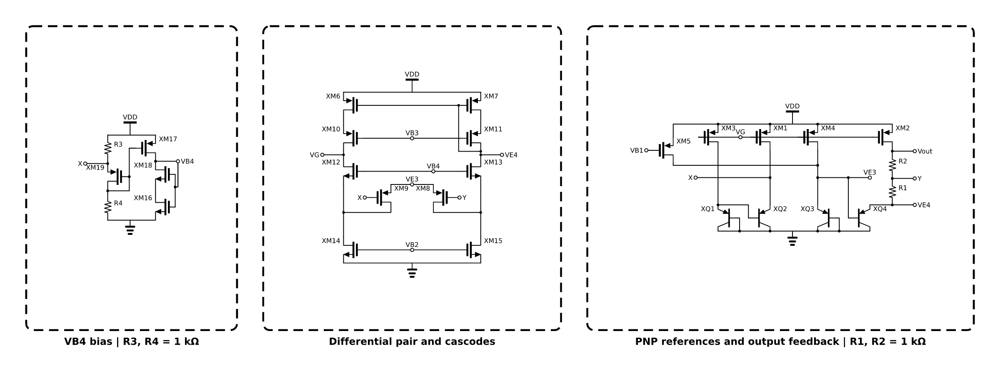
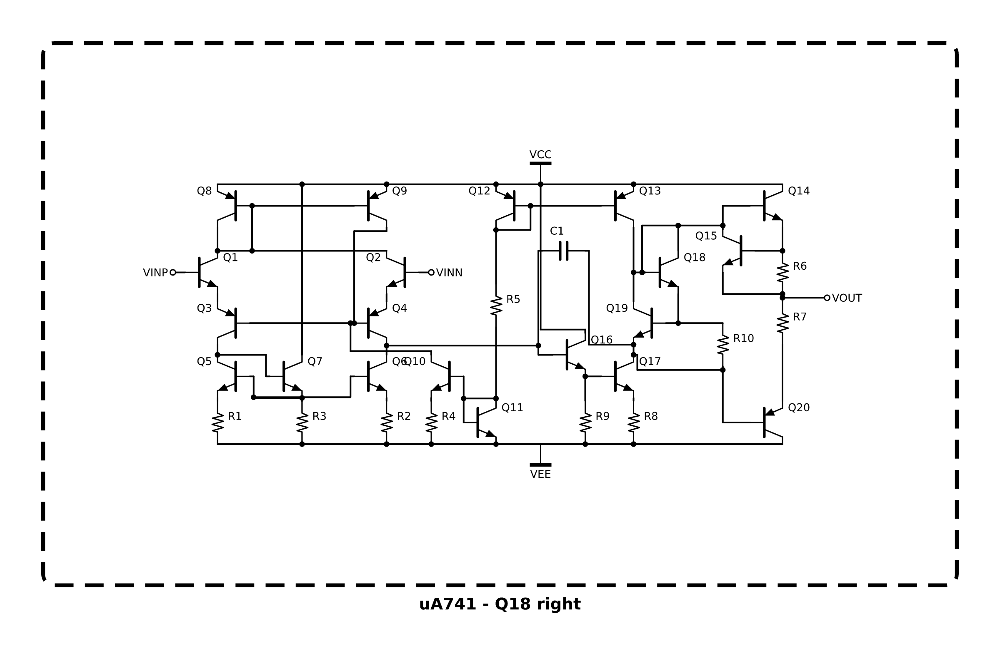
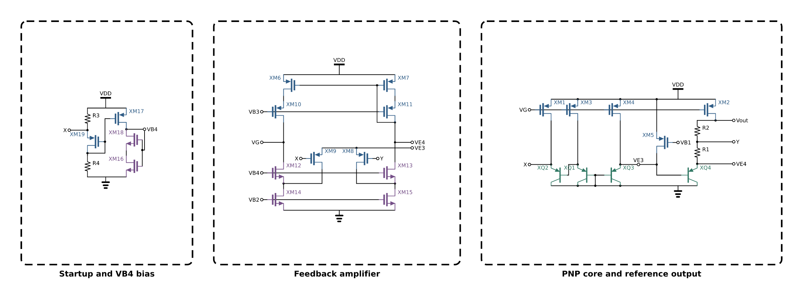
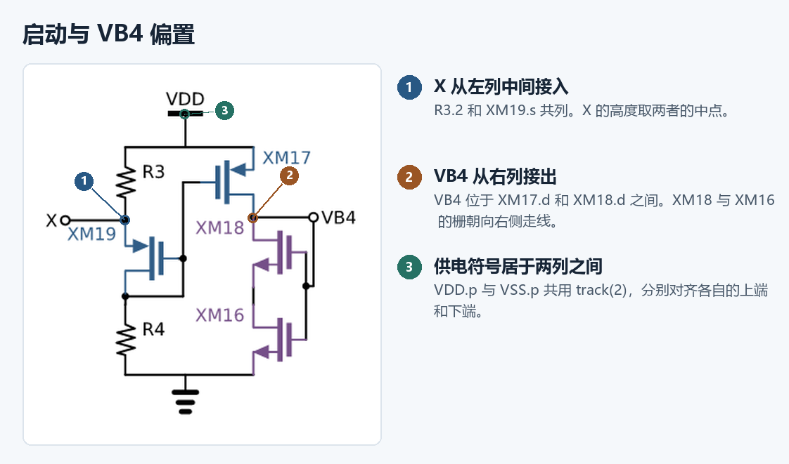
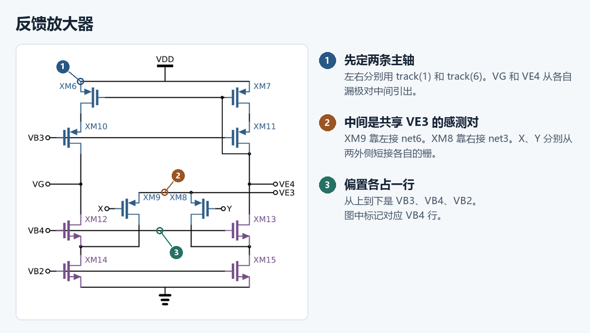
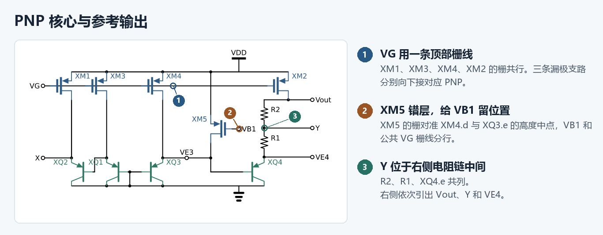
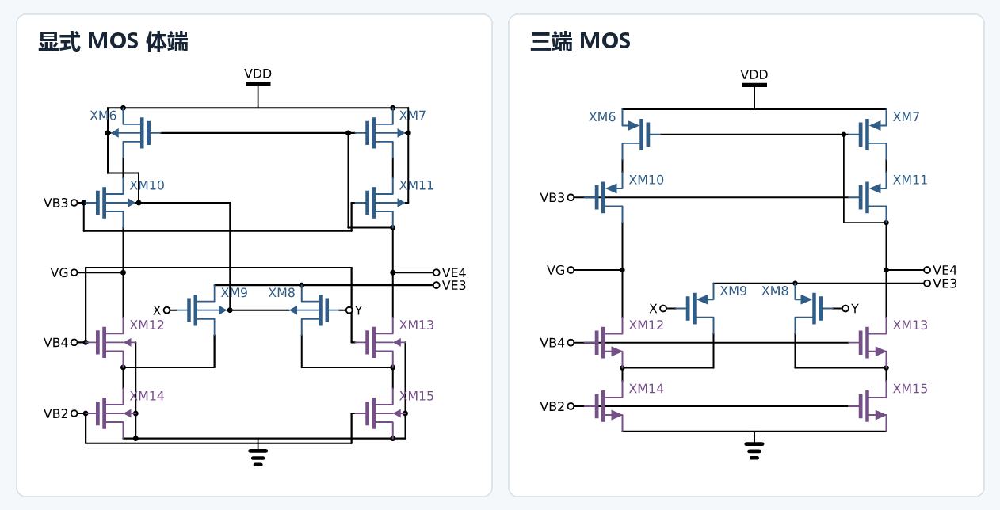

<h1 align="center">UniSchematic</h1>

**【每次阅读请完整读完而不是截取部分】**

<p align="center">模拟电路原理图自动布局与布线 · USC 设计手册（兼 Skill）</p>

<p align="center">
  <a href="https://github.com/KonataLin/UniSchematic/releases/latest"><strong>下载</strong></a>
  · <a href="./examples/README.md">示例</a>
  · <a href="#usc-layout-methods">通用构图方法</a>
  · <a href="#usc-sky130-case">SKY130 实战复盘</a>
</p>

<p align="center">
  <a href="#usc-sky130-case">
    
  </a>
</p>
**前言：本 README 的语法手册由作者撰写**，请**您严肃遵循 UniSchematic 的 License 规范**

如果你是 AI Agent，请完整读取本 README，包括末尾的通用构图方法与 SKY130 实战复盘。若工具截断输出，请从截断处继续读到文件末尾。USC 语法和命令以正文为准。

> **专有非商用授权 / Proprietary non-commercial license**
>
> The UniSchematic executable and USC documentation are governed by the
> [proprietary license](./LICENSE). You and AI agents acting on your behalf
> may use the specification to author USC files and render them with the
> official binary for personal or academic non-commercial work.
>
> The agreement prohibits unauthorized commercial use, reverse engineering,
> use to build third-party parsers or competing engines, and automated
> harvesting of input/output pairs to train or benchmark competing systems.
>
> UniSchematic 可供个人学习、教育与非商用学术研究使用。协议禁止未经许可的
> 商用、逆向、利用 USC 规范开发第三方解析器或竞品，以及为竞品训练用途批量
> 采集输入与输出。符号数据的独立许可和上游来源见 [symbols](./symbols/ORIGIN.md)。

---

## ★USC 设计理念与使用规范

**【每次阅读请完整读完而不是截取部分】**

UniSchematic 旨在给画图模型薄弱的模型、需要快速出图的模型使用，快速综合一个人类可读的电路。**示例参考 [examples 文件夹](./examples/README.md)（一些 <u>好的</u> 设计范例供你参考！）**。

### 1 USC 工作原理：

**【每次阅读请完整读完而不是截取部分】**

· USC 将整个 schematic 分为无限个竖直的 track，每个 track 上面按照顺序像葡萄一样挂入一些元件（FIFO 顺序挂入一些元件），你通过分配元件的旋转方式和从属的 track 来构思出好看的 schematic；

​	至于这些 track 的间距、元件的排列方式则由 USC 布局布线器给出，

​	你只要思考怎么设计 track 让整个 schematic 更加规整（要预先考虑到布局布线）在哪些 track 如何排列元件 如何旋转元件……

· USC **支持 module 模块化和模块复用，你在每个 module 里头设计完 track（元件排列方式） 之后**，重复的模块可以在 layout 中指出合适声明！因此，如何把一个大块电路（如果足够小就不必了）按照功能合适区分出模块，这也是之后在阅读本文需要考虑的。综合器逐块检查布线电气连通和几何；顶层连接和电路功能需要你自行核对。当前发行版不运行内部 LVS。

### 2 USC 电路图绘制

**【每次阅读请完整读完而不是截取部分】**

· 这一小节包含了 USC 语法的主要理念：轨道挂元件理念；这方便你更好地去思考元件怎么摆放，电压怎么在 track 内部从上往下流动 信号怎么在 track 之间传播，需要你利用我们的理念想清楚，这会比直接使用坐标绘图方便许多；

#### 2.1 track 关键字 ——创建轨道

**【每次阅读请完整读完而不是截取部分】**

· track 用来指定竖直轨道，创建一个竖直轨道；需要注意的是，**轨道不代表间距，相邻轨道之间的距离是由综合器给出的**；使用方法为 track(0) 或者 track(3) 同时也支持小数，例如 track(2.5) 表示在 track(2) 和 track(3) 中间那条轨道；**防止写一半发现：哦这个元件应该放在这两个元件中间** 小数轨道是这个作用；**但是需要注意 track(2.01) track(2.99) track(2.5) 同时代表同一条轨道**；

**如何在 track 上挂元件**：每个元件只能被挂一次。**你可以指定某个元件的某个端子作为锚点（端子名通过 `-instance` 查找）**，固定在某个 track 上（具体在哪不用你操心 会通过综合器来算出 你只需要在内心里估计怎么放置是美观符合 IC 拉扎维规范的）。普通器件名也可作为锚点，但应尽量少用，尤其是主电流支路、对称支路和需要精确共轴的器件。除 `port` 外，尽量指定具体端子，避免器件包络中心带来的歧义，例如 `MP.s`、`MN.d`、`RZ.1`、`VDD.p`。**`port` 直接写端口名即可（如 `VBN`、`{out}`）**。

**★额外注意**：每个器件只能有一个 `track` 锚点。器件的朝向由 `face` 等朝向约束确定。

**含义**：声明编号为 `k` 的竖直列，编号从小到大对应**从左到右**的 X 坐标顺序；冒号后用逗号分隔的元素严格按从上到下（FIFO）排布。

**举例**：

``` code
	track(0): {x}
	track(1): RZ_{phase}.1
	track(2): CZ_{phase}.1
	track(2.5): {cm}                 # 插在列 2 与列 3 之间
	track(3): MP_{phase}.s, MN_{phase}.d
	track(3.5): VDD.p, VSS.p         # 插在两列推挽管之间，精确居中用 center_x
	track(4): AP_{phase}.s, AN_{phase}.d
```

#### 2.2 face关键字——调节元件旋转方向

**【每次阅读请完整读完而不是截取部分】**

· 依旧，需要你通过 -instance 指令来查找端子，这里需要支持两种语法形式：

1. **单引脚简写**（常用于电源/地）：

   ```
   face VDD.p down
   face VSS.p up
   ```

2. **批量键值写法**（多个同名朝向的器件/端口用空格隔开，冒号后写 `引脚:方向`）：

   ```
   face MBP MDP MXP: g:left s:up
   face MBN MDN MXN: g:right s:up
   face CP_{phase} CN_{phase} RP_{phase} RN_{phase}: 1:left 2:right
   face C_D: 1:up 2:down
   face VBP VBN XP VINP: p:right
   face XN VINN: p:left
   ```

你需要考虑一个问题：约束需要把旋转或镜像方向定下来。**例如 MOS 只指定栅极方向，仍可能有两种镜像。** 推荐用 `face` 同时指定栅极和源极（或漏极）的方向。也可以把 `face M1: g:left` 和同一器件的 `above M1.d M1.s` 配合使用。旋转方向会极大地影响电路的美观性，需要你思考怎么旋转综合出来的线不会绕来绕去！

**端口(port)朝向是比较特殊的（最容易写反！）**：`p:<方向>` 表示**引脚朝哪边连向电路内部**：

- 放在模块**左边界**的端口 →\to→ 导线向右接入电路 →\to→ 必须写 **`p:right`**；
- 放在模块**右边界**的端口 →\to→ 导线向左接入电路 →\to→ 必须写 **`p:left`**。

#### 2.3`align_y` —— 水平等高对齐与中点对齐

**【每次阅读请完整读完而不是截取部分】**

· **多目标等高对齐**（支持 2 个及以上目标，一次写齐）：

```
align_y MBP.s MBN.s MDP.s MDN.s VDD.p
align_y RZ_{phase}.1 CZ_{phase}.1 {out} MP_{phase}.d
```

· **中点对齐 `align_y A (B C)`**：将目标 `A` 的 Y 坐标精准对齐到 `B` 与 `C` 的**垂直中点**。

```
align_y MSA.g (RS_P.2 RS_N.2)           # 栅极对准两颗采样电阻右端正中
align_y VCM_CTRL (MLB.d MSB.d)          # 输出口对准上下管漏极正中
align_y RP_{phase}.1 (AP_{phase}.s AP_{phase}.g)
```

#### 2.4 `above A B` —— 严格上下层级约束

**【每次阅读请完整读完而不是截取部分】**

- 强制 `A` 位于 `B` 上方（`A`、`B` 可为器件名或具体引脚名）。

- **常规分层**：拉开上下级电源与管子之间的垂直通道：

  Plaintext

  ```
  above IREF MNREF
  above MDP.d MXP.s
  above MXP.d MIP.d
  above MP_{phase}.d MN_{phase}.d
  ```

​	· **Special Notice!!**: 你需要避免这样的环：A 和 B 是严格错位的 但是又通过别的约束让他们对齐 比如 C 上面的元素和它下面的元素对齐 align_y 这样在数学上是 not accept 的！你用这个的时候需要注意这一点 避免不可能的布局结果！

#### 2.5 `center_x A (B C)` —— 水平居中对称约束

**【每次阅读请完整读完而不是截取部分】**

将 `A` 的 X 坐标锁定在 `B` 和 `C` 的水平正中，常用于尾电流管对准差分对、公共电源/地对准左右对称支路：

```
center_x MTAIL.d (MIP.s MIN.s)
center_x MST.d (MSA.s MSB.s)
```

​	· **Special Notice!!**: 2.3 - 2.5 相互配合 是有可能产生数学上无解的情况的 请在三检查避免不可能的布局（impossible layout）

### 3 模块化设计与文件声明

**【每次阅读请完整读完而不是截取部分】**

#### 3.1 circuit 命名空间

**【每次阅读请完整读完而不是截取部分】**

**`circuit` 是命名空间，`module` 是 Circuit 内部的绘图单元**：

​	一个 `.usc` 文件由一个或多个 `circuit Name { ... }` 构成。**它声明了一块画布**。 

#### 3.2 module 子模块

**【每次阅读请完整读完而不是截取部分】**

​	你可以通过**子模块来让电路更加层次化且更清晰**，因此，你有**必要搞清楚你的电路是什么功能并作合适的拆分**！如果模块间是相接的，你可以声明一个 port （见 example）出去，在另外一个 module 也声明一个 port 进来；值得注意的是，**一个布局良好的 schematic 应该是适当拆分的，粒度不会过细也不会过粗，有一定层次化（比如 Bias 单独拿出来），但是又不全放在一起**；(Example 中两个例子 一个是全部挤在一起 但是因为良好的布局 仍然有一定的美观性，另一个则是分了恰当的模块化 + 模块复用 因此看起来也比较美观)

​	子模块可以被复用，用于描述电路中的重复性结构单元；

​	参数化 `module` 一例：

```
circuit OTACells {
  module OutputStage(phase, x, out, cm, color) {
    title "Output {phase} with edge assist"
    ...
  }
}
```

**纯字符串模板替换**：参数全部视为纯字符串，使用 `{param}` 占位，可出现在 `title`、器件名、内联颜色、网名、`port` 名和任意布局约束中；**不支持表达式求值**（如 `{i+1}` 非法）。

**`title "..."`**：可选语句，指定渲染时虚线框正下方居中的标题文本，必须独占一行。

#### 3.3 layout —— 最终把 module 放在一起！实现 module 复用！	

**【每次阅读请完整读完而不是截取部分】**

​	在设计完各个子 module 后，入口文件在一个 `circuit` 内写恰好一个非空 `layout` 来调用 module。通过 `include` 引入的库文件可以只写模块定义：

​	下面是我们把 module 都放在 stages.usc 设计完成了 你当然可以单独做成一个文件 这随你的文件管理模式来操作！

```
# 顶层入口文件（如 top.usc）
circuit DifferentialEdgeOTA {
  include "stages.usc"        # 引入同一工程/目录下的模块库文件

  layout {                    # 按书写顺序从左到右横向排布各模块
    OTACells.Bias()
    OTACells.InputStage()
    OTACells.OutputStage(
      phase = P;N,
      x     = XP;XN,
      out   = VOP;VON,
      cm    = VCM_CTRL,       # 长度为 1 的参数自动广播
      color = #B35B25;#805AA7
    )
    OTACells.CommonMode()
  }
}
```

**注释**：以 `#` 开头至行尾。

**模块引用**：同 `circuit` 内可直接写 `ModuleName(...)`，跨 `circuit` 写 `CircuitName.ModuleName(...)`。

**单文件写法**：不需要拆文件时，可以直接把 `module ... { ... }` 和 `layout { ... }` 写在同一个 `circuit` 块中。

**`;` 批量展开规则（Zip + 广播）**：

​	调用参数值中用 `;` 分隔表示列表（如 `phase=P;N` 长度为 2）。

​	同一次调用中的多个列表按同下标一一配对（Zip）展开成多个横向连续模块，不做笛卡尔积。

​	长度为 1 的标量参数（如 `cm=VCM_CTRL`）自动广播给本次展开的所有实例。

​	若同一调用中存在两个长度均大于 1 且不相等的列表，编译器报错。

### 4 常用的元件一列

**【每次阅读请完整读完而不是截取部分】**

每个语句独占一行，声明格式为：

```
<器件名>[(<#RRGGBB>)] <网络1> [<网络2> ...] <器件类型>
```

- **内联颜色**：可选，写在器件声明名后的括号内，如 `IREF(#25805C)` 或 `MP_{phase}({color})`。**仅在声明处写一次**，后续约束中仍使用原器件名（如 `IREF`、`MP_{phase}`）。

| **器件类型**         | **声明格式（网络顺序严格固定）**  | **引脚名（用于约束）**   | **face 合法写法示例**     |
| -------------------- | --------------------------------- | ------------------------ | ------------------------- |
| **`NMOS`**           | `M1(#hex) <D> <G> <S> NMOS`       | `.d`, `.g`, `.s`         | `face M1: g:left s:down`  |
| **`PMOS`**           | `M2(#hex) <D> <G> <S> PMOS`       | `.d`, `.g`, `.s`         | `face M2: g:right s:up`   |
| **`NPN`**            | `Q1(#hex) <C> <B> <E> NPN`        | `.c`, `.b`, `.e`         | `face Q1: b:left e:down`  |
| **`PNP`**            | `Q2(#hex) <C> <B> <E> PNP`        | `.c`, `.b`, `.e`         | `face Q2: b:left e:up`    |
| **`CURRENT_SOURCE`** | `I1(#hex) <P> <N> CURRENT_SOURCE` | `.p`, `.n`               | `face I1: p:up n:down`    |
| **`RESISTOR`**       | `R1(#hex) <1> <2> RESISTOR`       | `.1`, `.2`               | `face R1: 1:left 2:right` |
| **`CAPACITOR`**      | `C1(#hex) <1> <2> CAPACITOR`      | `.1`, `.2`               | `face C1: 1:up 2:down`    |
| **`SUPPLY_SYMBOL`**  | `VDD <net> SUPPLY_SYMBOL`         | `.p`                     | `face VDD.p down`         |
| **`GROUND_SYMBOL`**  | `VSS <net> GROUND_SYMBOL`         | `.p`                     | `face VSS.p up`           |
| **`port`**           | `port <net>`                      | `.p`（或直接写 `<net>`） | `face VBN: p:right`       |

> **关键易错点——MOS 网序**：与 SPICE 一致，严格为 **`漏极(D) 栅极(G) 源极(S)`**，且不包含体端（Bulk）。不要把源极和漏极写反。

### 5 可能遇到的问题

**【每次阅读请完整读完而不是截取部分】**

**禁止残留未定义语句或换行黏连**：`title "..."` 之后必须换行再写第一条器件声明。器件和约束语句写在 `module` 内，`layout` 只写模块调用。

**等价的约束留一条即可**：同一条 `track` 里选中的锚点已有相同的 X 坐标（例如写了 `track(4): VDD.p, MTAIL.d, VSS.p` 后，`center_x MTAIL.d (MIP.s MIN.s)` 就能把这条轨道放在两点正中）。

**禁止 `align_y` 与 `above` 冲突**：若写了 `align_y A B`，绝对不能再对 `A` 和 `B`（或其同高传递节点）写 `above A B`。

**同列 FIFO 顺序必须与 `above` 一致**：如果 `track(1): A, B`（`A` 在 `B` 上），就不能在别处写 `above B A`，也不能把 `B` 的源极和 `VDD.p` 对齐而把 `A` 和 `VSS.p` 对齐。

**检查每条跨块网是否漏写 `port`**：总图用同名端口标识跨块接口。普通网连到两个及以上模块时，漏写同名 `port` 会给出警告。核对跨模块信号在发送块和接收块都有同名 `port`。

**检查端口方向有没有反**：再次确认最左列端口全是 `p:right`，最右列端口全是 `p:left`。

**检查 `;` 列表长度对齐**：`layout {}` 调用中，所有含 `;` 的参数长度必须完全一致（标量除外），且 `{param}` 拼写与 `module(...)` 签名一字不差。

**检查 `NMOS`/`PMOS` 引脚顺序**：逐行确认第 1 个网是 Drain、第 2 个是 Gate、第 3 个是 Source。

---

## Commercial Licensing / 商业授权

**【每次阅读请完整读完而不是截取部分】**

For commercial licensing, contact [wenkang_dou@163.com](mailto:wenkang_dou@163.com).

## Quick Start / 快速调用

**【每次阅读请完整读完而不是截取部分】**

Download the archive for your system from GitHub Releases, then extract it.
Run these commands from the extracted directory in PowerShell.

```powershell
.\unischematic.exe --license
.\unischematic.exe -run examples/ua741-q18-right/main.usc --accept-license
.\unischematic.exe -instance inductor
```

On Linux and macOS use `./unischematic`. First use requires explicit
agreement. An interactive terminal may enter `yes` after reviewing the terms.
The binary records acceptance locally and asks again when the agreement changes.

### 出图失败怎么查

**【每次阅读请完整读完而不是截取部分】**

每次运行前，输入 `yes` 表示已深度理解本 README（包括末尾的两篇构图参考）及当前网表的结构和信号流向。反复碰运气试 `track` 或约束，说明还没有理清信号流向。即使 lint 显示 PASS，这样画出的图仍会被用户退回返工。

编辑或重跑前，必须完整重读本 README，除非你确实记得每种设计方法和全部 USC 语法细节。lint 报错表明当前输入没有完全应用文档中的规则。加 `-json` 可读取同样的 `code`、`span`、`related` 和 `hint`。

> [!WARNING]
> **SPECIAL WARNING**
>
> 读过 README 只是第一步，当前方案仍需符合其中的规则。同类 lint 问题在修改后再次出现时，必须按程序提示从头到尾重读 README，核对当前方案是否符合规则，再继续修改。完整读一遍可以减少反复试错消耗的 token。回复 `yes`、声称已经理解或重复尝试，都不能替代这一步。

- 提示 `track(k) requires 'A' above 'B'` 时，错误位置会列出轨道和两个锚点。
- `E_EQUALITY_INFEASIBLE` 会列出参与冲突的 `align_y` 或 `center_x` 语句及其位置。这些约束在计入引脚位置后无法同时成立。
- 端子数、端子名或朝向报错时，错误位置会列出模块和源码行。

完整的网表转图案例、摆位标注和两版 USC 见下方的 [SKY130 实战复盘](#usc-sky130-case)。

## uA741 示例图

**【每次阅读请完整读完而不是截取部分】**



---

<a name="usc-layout-methods"></a>

## 从 Netlist 到 USC：模拟电路原理图构图的深度思维模型与实战策略（Reference）

**【每次阅读请完整读完而不是截取部分】**

> **版权与使用边界提示（All Rights Reserved）**
>
> 本文档为 **UniSchematic (USC)** 项目的构图方法论深度参考指南，受仓库根目录专有许可协议约束。仅限授权个人、学术研究者及受托 AI Agent 用于学习构图思维、编写 `.usc` 源文件并调用官方引擎渲染原理图；严禁基于本文档中的语法体系或抽象思想开发第三方解析器、转译器或同类竞品。

---

### 序言：画得漂亮的本质，不是“摆坐标”，而是“帮人眼重建物理直觉”

**【每次阅读请完整读完而不是截取部分】**

很多初学者（包括大多数通用大模型）第一次拿到一份 SPICE 网表准备画图时，下意识的做法是**把网表当成代码逐行翻译**：第一行是 `M1`，那就先放 `M1`；第二行是 `M2`，就把它挨着 `M1` 放。这种做法画出来的图纸，哪怕没有一根线连错，在模拟电路工程师眼里也是“不可读的灾难”。

为什么？因为 **SPICE 网表是一个无序的电气超图（Hypergraph），而一张出版级的模拟电路原理图，本质上是一个二维的“电势与信号场”**：
* **纵轴（Y 轴）承载的是直流电势梯度**：从最顶端的 $V_{DD}$ 一路流向最底端的 $V_{SS}$，电流永远沿着重力方向“从上往下流”；
* **横轴（X 轴）承载的是交流信号因果链**：微弱的输入信号从最左侧进入，经过跨导级、增益级、补偿网络、输出驱动级，一路向右流向负载；
* **左右对称性承载的是匹配与差分语义**：两颗在版图上需要严格匹配的差分管或电流镜，在原理图上必须镜像对称，让人眼在 $0.3\text{ s}$ 内完成模式识别。

我在将一份复杂的裸网表转化为干净漂亮的 `.usc` 文件时，脑子里从来不是在算“这颗管子该放在 $(x=120, y=340)$”，而是在做一套极其系统的**五层思考流水线**：**拓扑剥离 $\rightarrow$ 最小割切块 $\rightarrow$ 弹性轨道骨架 $\rightarrow$ 引脚逃逸朝向 $\rightarrow$ 最小约束锚定**。

本文档将毫无保留地把这套构图思考过程、踩过的坑、以及针对各类棘手模拟拓扑的破局心法完整拆解出来。

---

### 第一章：拿到网表后的前 60 秒——如何对无序网表做“拓扑剥离”

**【每次阅读请完整读完而不是截取部分】**

面对一份 $30 \sim 100$ 颗器件的原始 SPICE 网表，直接动笔写 `.usc` 必然翻车。我的第一步永远是**先读懂电路，再决定画法**，按固定顺序在脑中剥离出五个层次：

#### 1.1 第一刀：锁定全局轨与剔除体端（Bulk）

**【每次阅读请完整读完而不是截取部分】**
SPICE 网表里的 MOS 管通常是四端写法（`M1 D G S B model W=... L=...`）。阅读时先做两件减法：
1. **识别电源与地**：找出全局的高电位轨（$V_{DD}$ / `AVDD`）和低电位轨（$V_{SS}$ / `GND`）。它们决定了整张图的“天花板”和“地板”。
2. **剥离体端（Bulk）与器件尺寸**：USC 只保留 `D G S` 三端连接关系；器件尺寸 $W/L$ 留在仿真网表中，绝不让多余参数干扰构图骨架。

#### 1.2 第二刀：按“二极管接法”剥出偏置树（Bias Tree）

**【每次阅读请完整读完而不是截取部分】**
在网表中快速扫一遍，凡是满足 **$D$ 端网络名与 $G$ 端网络名完全相同** 的 MOS 管（例如 `MNREF VBN VBN VSS NMOS`），99% 是偏置参考管或电流镜主支路。
* 顺着这个栅极网络（如 `VBN`、`VBP`）往外追踪：哪些管子连着它的栅极？
* 如果某个子网络只负责把参考电流 `IREF` 镜像成若干条偏置电压（`VBN`、`VBP`），直接把这群管子打包划进最左侧的 `Bias` 模块。

#### 1.3 第三刀：按“共享源极”与“交叉栅漏”抓取核心对称核

**【每次阅读请完整读完而不是截取部分】**
接下来在主信号通路里找两类最具决定性的对称结构：
1. **差分对（Differential Pair）**：两颗同类型管子共享同一个非电源/非地的源极节点（如 `TAIL`），且 `TAIL` 下方（或上方）连着一颗受偏置控制的尾电流管。它们天然构成一个**左右镜像的 V 字/倒 T 字对称核**。
2. **交叉耦合对（Cross-Coupled Pair / Negative-$g_m$）**：两颗管子满足 `M_A` 的漏极接 `M_B` 的栅极，且 `M_B` 的漏极接 `M_A` 的栅极（如 `MXP XP XN VDD` 与 `MXN XN XP VDD`）。**一旦看到这种结构，立刻在脑中打红标**：这是全图最容易造成走线重叠打架的“雷区”，后面必须用 `above` 故意错层。

#### 1.4 第四刀：追踪信号链，区分“主通路”与“辅助支路”

**【每次阅读请完整读完而不是截取部分】**
从输入端口（`VINP` / `VINN`）出发，顺着“栅极进 $\rightarrow$ 漏极出 $\rightarrow$ 下一级栅极进”的顺序往右推：
* 推到输出端口（`VOP` / `VON`）的那条路径就是**主信号干道**；
* 凡是从 `VOP` / `VON` 绕回来采样、再生成控制电压（如 `VCM_CTRL`）喂回前级的，全部剥离为独立的**反馈环路（CMFB / Servo）**；
* 凡是跨接在级间输出与输入之间的电阻/电容（如米勒补偿 `RZ`/`CZ`，或交流耦合加速网络 `CP`/`CN`/`RP`/`RN`），标记为**桥接无源网络**。

完成这四刀后，一份原本密密麻麻的网表在脑中就已经变成了一张清晰的**宏观框图**：左侧是绿色偏置源，中间是蓝色对称输入级，右侧是橙/紫对称输出与驱动级，最右端是湖蓝色共模反馈级。

---

### 第二章：与求解器“共情”——理解 USC 的物理心智模型

**【每次阅读请完整读完而不是截取部分】**

想要一次写出美观的 `.usc`，不能把关键字当死记硬背的语法，而要理解它们在几何空间里产生的**力学效应**。我在写每一条约束时，脑子里运转的是下面三个心智模型：

#### 2.1 `track(k)` 是“弹性垂直走廊”，不是死板坐标格

**【每次阅读请完整读完而不是截取部分】**
很多习惯了传统 CAD 的人会把 `track(0), track(1), track(2)` 误解成等宽的固定格子，于是拼命去算“这列会不会太窄、那列会不会撞上”。

其实恰恰相反：`track(k)` 只声明**从左到右的拓扑次序**和**同列元素的水平中心对齐**。两列之间到底隔多宽，引擎会根据中间需要穿过多少根竖直总线、器件本体有多宽来动态撑开。因此：
* **把需要垂直对齐、走同一条直流电流的器件放进同一条 `track`**，让电源到地的电流路径笔直如尺；
* **给需要横向舒展的桥接元件（如串联电阻+电容 `RZ` $\rightarrow$ `CZ`）各自分配独立的 `track`**，不要把它们硬挤在同一列里；
* **善用小数轨道（如 `track(2.5)`、`track(3.5)`）做“零面积插缝”**：`port`、`VDD.p`、`VSS.p` 是零面积端点。当你发现两列主器件正中间需要摆一个公共电源符号，或者需要在驱动级前插一个局部偏置端口 `{cm}` 时，直接开一条 `track(3.5)` 或 `track(2.5)` 插进去。它既不用你把后面所有整数列号统统重编，又能精准占据两列之间的自然缝隙。

#### 2.2 垂直有向无环图（Vertical DAG）直觉

**【每次阅读请完整读完而不是截取部分】**
所有决定 Y 轴位置的信息都来自三个地方：
1. 同一 `track(k): A, B, C` 的书写先后顺序（隐含了 $y(A) > y(B) > y(C)$）；
2. 显式的 `above X Y`（强约束 $y(X) > y(Y)$）；
3. 显式的 `align_y X Y`（强等式 $y(X) = y(Y)$，相当于把两个节点在垂直图里捏合成同一个超级节点）。

**写约束时，脑中必须时刻盯着这张 DAG 不能出现环路**：
* 假如 `track(1)` 里写了 `A, B`（暗示 `A` 在 `B` 上面），同时另一处 `align_y` 又把 `B` 拉得和 `A` 一样高（或通过传递链 `align_y B C` + `above C A` 绕回了 `A` 上方），垂直图就会出现逻辑死锁或把整幅图拉扯变形。
* **黄金检验法**：每一条 `align_y` 都应当连接“处于同一电势层级”的跨列引脚（横向拉齐），而 `above` 与 `track` 内部顺序则负责拉开不同电势层之间的垂直走廊（纵向分层）。**横用 `align_y`，纵用 `above`，绝不混用。**

#### 2.3 “最小充分约束”原则：少即是多

**【每次阅读请完整读完而不是截取部分】**
新手最容易犯的错，是生怕引擎画不好，于是把图里每一对引脚之间都写满 `align_y` 和 `above`。结果往往是**过约束（Over-constrained）**：布线器本来只需要把两排管子稍微拉开一点点就能零交叉穿过一条横向总线，却被你多余的 `align_y` 死死钉住，逼着导线绕大圈。

我的策略是**只锁“视觉骨架线”，其余全部放手交给引擎**：
1. 锁死天花板（顶排源极与 `VDD.p` 共 `align_y`）和地板（底排源极与 `VSS.p` 共 `align_y`）；
2. 锁死差分对称件的水平等高（如 `align_y MIP.d MIN.d`）与对称轴居中（`center_x MTAIL.d (MIP.s MIN.s)`）；
3. 锁死外部端口到其目标引脚的直连高度（如 `align_y VINP MIP.g`）；
4. 仅在发生交叉冲突或上下层间距过紧时，补加精准的 `above`。

---

### 第三章：宏观架构策略——大型电路怎么切块才不乱？

**【每次阅读请完整读完而不是截取部分】**

当电路规模超过 $16$ 颗器件时，硬画成一整张巨无霸单图有两个致命问题：第一，跨级长飞线会像蜘蛛网一样横穿中间的所有模块；第二，人眼一次能清晰聚焦的视觉区块大约只有 $6 \sim 12$ 颗管子，太密就会丧失层次感。

#### 3.1 切块的数学本质：语义感知的“最小割（Min-Cut）”

**【每次阅读请完整读完而不是截取部分】**
切分 `module` 不是随便按器件数量均分，而是寻找网表里的**高阻低扇出窄颈（Bottleneck Nets）**：
* **最佳切口**：级间电压节点（`XP`、`XN`）、全局偏置线（`VBN`、`VBP`）、反馈控制电压（`VCM_CTRL`）、最终输出端（`VOP`、`VON`）。这些节点通常只从前级漏极输出，进入后级栅极，边界清晰、语义独立。
* **绝对禁区（绝不要在这里下刀）**：
  * **不要把差分对从中间劈开**（共享 `TAIL` 节点且往往有交叉耦合）；
  * **不要把电流镜的参考管与紧耦合的有源负载劈开**；
  * **不要把米勒补偿电容/电阻与它所补偿的那一级输出管拆到两个模块里**。

#### 3.2 破解反馈死循环：把“闭环”拉成“直线”

**【每次阅读请完整读完而不是截取部分】**
模拟电路里充满了闭环（如 CMFB 从输出 `VOP`/`VON` 采回来控制前级 PMOS 栅极 `VCM_CTRL`）。如果试图在物理画布上拉一根长导线从最右边折返到最左边，整张图的顶部或底部就会被长回环线彻底破坏。

USC 的破局思路极其优雅：**利用同名 `port` 将反馈闭环在视觉上切开拉直**。
* 把 `CommonMode`（CMFB）稳稳放在整个 `layout` 队列的最右侧；
* 左侧输入端口接 `VOP`、`VON`、`VBN`，右侧输出端口直接引出 `VCM_CTRL`；
* 在前面的 `OutputStage` 里声明同名端口 `port VCM_CTRL` 直接喂给上拉 PMOS 栅极。

这样一来，图纸可以从左到右阅读。各模块内部的布线会检查连通性，跨模块关系按两端的同名端口与原网表核对。

#### 3.3 何时用“块内镜像对称”，何时用“`;` 向量模板复制”？

**【每次阅读请完整读完而不是截取部分】**
这是决定 `.usc` 代码优雅程度的分水岭。我的判断标准非常简单——**看两半边电路之间有没有“横向纠缠”**：
* **存在内部纠缠（共用尾电流管、交叉耦合、电阻桥接）$\rightarrow$ 必须合在同一个 `module` 内做镜像对称**。例如 `InputStage` 中的 `MXP`/`MXN` 互连栅漏、`MIP`/`MIN` 共用 `MTAIL`，它们在物理上就该围绕中间的 `track(4)` 左右对称展开。
* **两半边结构完全同构且无内部互连 $\rightarrow$ 必须抽成带参 `module`，用 `;` 向量批量展开**。例如全差分放大器的正负输出级 `OutputStage(phase=P;N, x=XP;XN, out=VOP;VON, cm=VCM_CTRL, color=#B35B25;#805AA7)`。不仅代码量直接砍半，还从根本上保证了 `P` 通道和 `N` 通道在排版几何上 $100\%$ 同构、绝不走样。

---

### 第四章：轨道规划图谱——六大模拟拓扑的空间骨架原型

**【每次阅读请完整读完而不是截取部分】**

熟练之后，看到任何模拟电路，脑中都能瞬间映射到以下六种经典 `track` 骨架之一：

#### 原型一：双列偏置基准型（Bias Reference）

**【每次阅读请完整读完而不是截取部分】**
* **结构**：电流源驱动 NMOS 二极管支路 + PMOS 二极管支路镜像。
* **轨道规划**：
  * `track(0)`: 左输出偏置端口（`VBN`）
  * `track(1)`: 左电流支路（`IREF.p, MNREF.d`）
  * `track(2)`: 中央公共电源/地轴（`VDD.p, VSS.p`）
  * `track(3)`: 右电流支路（`MPREF.s, MNB.d`）
  * `track(4)`: 右输出偏置端口（`VBP`）
* **精髓**：把公共 `VDD.p` 和 `VSS.p` 夹在两条支路正中间的 `track(2)`，两条支路像两棵树一样对称挂在电源轨两侧，引线最短。

#### 原型二：多层翼展对称型（Cross-Coupled Input Stage）

**【每次阅读请完整读完而不是截取部分】**
* **结构**：偏置负载 + 二极管负载 + 交叉耦合负阻 + 差分输入对 + 尾电流管。
* **轨道规划**（典型的 $9$ 轨道对称翼展）：
  * `track(0)` / `track(8)`：左右边界端口对称（`VBP, XP, VINP, VBN` vs. `XN, VINN`）；
  * `track(1)` / `track(7)`：外翼偏置负载（`MBP.s` vs. `MBN.s`）；
  * `track(2)` / `track(6)`：中翼二极管负载（`MDP.s` vs. `MDN.s`）；
  * `track(3)` / `track(5)`：内翼核心信号柱（`MXP.s, MIP.d` vs. `MXN.s, MIN.d`）；
  * `track(4)`：神圣中轴线（`VDD.p, MTAIL.d, VSS.p`）。
* **精髓**：把连线最密集的交叉耦合管（`MXP`/`MXN`）和差分对（`MIP`/`MIN`）放在紧贴中轴线的 `track(3)` 和 `track(5)`，让跨中轴的交叉线距离压到最短；而只连单一节点的并联负载（`MBP`、`MDP`）依次向外翼展开，像展开的翅膀一样绝不挡住中心走廊。

#### 原型三：水平桥接 + 互补推挽输出型（Output Stage with Compensation）

**【每次阅读请完整读完而不是截取部分】**
* **结构**：输入信号既驱动主推挽管（`MP`/`MN`），又通过米勒零点阻容（`RZ`/`CZ`）桥接到输出，同时还通过交流耦合电容/电阻（`CP`/`CN`/`RP`/`RN`）驱动辅助边沿加速管（`AP`/`AN`）。
* **轨道规划**：
  * `track(0)`: 主输入端口 `{x}`；
  * `track(1)` & `track(2)`: 串联米勒网络 `RZ.1` $\rightarrow$ `CZ.1`（横跨在输入和主输出之间，形成直观的水平反馈桥）；
  * `track(2.5)`: 小数插缝轨道放入共模控制端口 `{cm}`，直插到主上拉 PMOS `MP` 的左侧栅极前；
  * `track(3)`: 主推挽输出柱（`MP.s, MN.d`）；
  * `track(3.5)`: 小数轨道居中放入 `VDD.p, VSS.p`，同时服务左侧主推挽和右侧辅助推挽；
  * `track(4)`: 辅助推挽柱（`AP.s, AN.d`）；
  * `track(5)` & `track(6)`: 辅助偏置与耦合 RC（`CP`/`CN` 占一列，`RP`/`RN` 占一列）；
  * `track(7)`: 最终输出端口 `{out}`。
* **精髓**：**主有源支路竖着走，补偿无源网络横着铺**，配合小数插缝轨道解决多电源和多栅极接入问题。

#### 原型四：折叠共源共栅型（Folded Cascode）

**【每次阅读请完整读完而不是截取部分】**
折叠结构最大的视觉特征是“信号在差分对漏极处向外水平折返，进入相邻的级联支路”。
* **轨道规划策略**：
  * 内侧列（`track(2)`、`track(4)`）放输入差分对，中轴 `track(3)` 放尾电流源；
  * 外侧列（`track(1)`、`track(5)`）放折叠级联柱（从上到下：`I_TOP` $\rightarrow$ `MCAS_P` $\rightarrow$ `MCAS_N` $\rightarrow$ `I_BOT`）；
  * **点睛约束**：用 `align_y` 将差分对的漏极与外侧折叠柱中对应的折叠节点（`MCAS_P.s` 或 `MCAS_N.s`）严格等高对齐，让“折叠电流”以一根完美的水平直线跨列汇入级联柱。

#### 原型五：采样比较反馈型（CMFB / Error Amplifier）

**【每次阅读请完整读完而不是截取部分】**
* **结构**：前端电阻分压网络（`RS_P`/`RS_N`）采样出 `VAVG` $\rightarrow$ 进入差分放大核（`MLA`/`MLB` + `MSA`/`MSB` + `MST`）$\rightarrow$ 输出端挂补偿电容 `C_D` 到地。
* **轨道规划**：
  * 左侧 `track(0)` 收 `VOP, VON, VBN`，紧接 `track(1)` 放水平分压电阻 `RS_P.1, RS_N.1`；
  * 中间 `track(3), track(4), track(5)` 走标准 5 管 OTA 对称核；
  * 右侧 `track(6)` 引出 `VCM_CTRL, VCM_REF`，最右 `track(7)` 垂直立起对地补偿电容 `C_D.1`。
* **精髓**：将采样电阻并排放在差分核正左方，并用中点约束 `align_y MSA.g (RS_P.2 RS_N.2)` 把左输入管栅极精确对齐在两颗采样电阻的正中，形成教科书般的对称 T 型汇流节点。

#### 原型六：多级级联管道型（Charge Pump / Ring Oscillator / Delay Chain）

**【每次阅读请完整读完而不是截取部分】**
对于几十颗管子重复串联的电路（例如 $N$ 级电荷泵、多级反相器链、多相时钟树）：
* **绝对不要展开写成几百行扁平网表！**
* 把单级单元抽象为 `module Stage(idx, in, out, clk, col)`，在顶层 `layout` 中利用**错位 `;` 向量**实现链式连接：

```text
layout {
  Stage(
    idx = 1;2;3;4,
    in  = VIN;N1;N2;N3,
    out = N1;N2;N3;VOUT,
    clk = PHI1;PHI2;PHI1;PHI2,
    col = #3267A8;#007A82;#3267A8;#007A82
  )
}
```
这种写法只需要 $20$ 行模板就能一口气生成 $4$ 级（甚至 $16$ 级）整齐划一、节拍配色交替的宏大电路图。

---

### 第五章：引脚朝向（`face`）的几何直觉——在布线前消灭鱼钩

**【每次阅读请完整读完而不是截取部分】**

如果说 `track` 决定了原理图的“骨骼”，那 `face` 就决定了布线的“血脉通畅度”。自动布线器产生难看的 U 型折返（鱼钩，Fishhook）和绕背长线，90% 的根源在于**相连的两个引脚“背道而驰”**。

我在写每一行 `face` 时，都会在脑中默念这五条铁律：

1. **电流顺流律（Source Orientation）**
   * PMOS 源极接高电位 $\rightarrow$ 永远 `s:up`；
   * NMOS 源极接低电位 $\rightarrow$ 永远 `s:down`；
   * 电流源正端接高电位 $\rightarrow$ `p:up n:down`；
   * 电源符号朝下喂电流 $\rightarrow$ `face VDD.p down`；地符号朝上接电流 $\rightarrow$ `face VSS.p up`。

2. **栅极迎源律（Gate Faces Driver）**
   * 看看这颗 MOS 管的栅极信号是从左边来还是从右边来：从左边端口或左列漏极过来，就写 `g:left`；从右边过来，就写 `g:right`。
   * **电流镜法则**：构成电流镜的一对管子（如 `CommonMode` 中的 `MLA` 与 `MLB`），左侧管设 `g:right`，右侧管设 `g:left`——让两颗管子的栅极**面对面**，中间只需一根短短的水平线一穿即过。
   * **对称输入法则**：差分输入对（`MIP` 与 `MIN`）通常由左右两侧端口驱动，因此左管 `g:left` 迎向 `VINP`，右管 `g:right` 迎向 `VINN`。

3. **背靠背推挽法则（Back-to-Back Parallel Stages）**
   * 在 `OutputStage` 中，主推挽管（`MP`/`MN`）在 `track(3)`，驱动信号来自左侧的 `{cm}` 和 `{x}`，因此设 `g:left`；而辅助推挽管（`AP`/`AN`）在 `track(4)`，它们的栅极由右侧 `track(5)` 的耦合电容 `CP`/`CN` 驱动，因此设 `g:right`。两列管子“背靠背”，把漏极共同朝向中间输出总线，各自栅极分别迎向左右两侧驱动源，走线零干扰！

4. **端口“向内伸出”律（Port Inward Rule）**
   * 这是新手和 AI 最容易写反的规则：**`port` 的 `face` 方向指的不是它在屏幕哪一侧，而是它的引脚“向哪里伸出连线”**。
   * 左边界端口（`track(0)`）要向右连进电路 $\rightarrow$ 一律 `p:right`；
   * 右边界端口（`track(max)`）要向左连进电路 $\rightarrow$ 一律 `p:left`；
   * 位于中间小数轨道的插缝端口（如 `track(2.5)` 的 `{cm}`），看它连向左侧还是右侧器件——连向右侧 `track(3)` 的 `MP.g`，所以写 `p:right`。

5. **无源器件（R/C）横竖决策树**
   * **跨列桥接（串联在信号路径或级间反馈中）** $\rightarrow$ 水平横放：`1:left 2:right`（如 `RZ`、`CZ`、`RS_P`、`RS_N`、`CP`、`CN`）。
   * **对地/对电源旁路（一端接信号节点，另一端接 `VDD` 或 `VSS`）** $\rightarrow$ 垂直竖放：`1:up 2:down`（如 `CommonMode` 中的对地补偿电容 `C_D`），让底部脚自然垂向地板轨 `VSS`。

---

### 第六章：约束精雕心法——从“画得对”到“出版级美感”

**【每次阅读请完整读完而不是截取部分】**

骨架搭完、朝向理顺之后，真正拉开“普通自动图”与“顶级手工精绘图”差距的，是四招极其精妙的相对约束技巧。

#### 6.1 齐平天花板与地板（视觉稳定锚）

**【每次阅读请完整读完而不是截取部分】**
任何模拟模块，只要存在多条并联到电源/地的支路，第一件事就是把顶部源极与 `VDD.p` 拉平，底部源极与 `VSS.p` 拉平：
```text
align_y MBP.s MBN.s MDP.s MDN.s VDD.p
align_y VSS.p MTAIL.s
```
这就像建筑图纸的地基线与屋檐线，只要这两条线笔直齐平，整张图的秩序感立刻提升一个档次。

#### 6.2 中点锚定 `align_y A (B C)` 的三大神级场景

**【每次阅读请完整读完而不是截取部分】**
`align_y A (B C)` 表示将 `A` 的纵坐标精确锁定在 `B` 和 `C` 的垂直中点 $\frac{y(B) + y(C)}{2}$ 上。在实战中有三个百试百灵的场景：
1. **推挽输出级引出端口**：把输出端口 `{out}` 对齐在 `MP.d` 与 `MN.d` 的正中，引出线直接从上下管漏极连线的正中央垂直 T 型分出；
2. **双支路采样汇合点**：把差分管栅极 `MSA.g` 对齐在上下两颗采样电阻右端 `(RS_P.2 RS_N.2)` 的正中，左右对称、走线等长；
3. **复杂辅助网络的“错落避障穿行”**（高阶秘籍）：
   请仔细品味 `OutputStage` 中这四行极其精妙的约束：
   ```text
   align_y CP_{phase}.1 AP_{phase}.g
   align_y CN_{phase}.1 (AN_{phase}.g AN_{phase}.s)
   align_y RP_{phase}.1 (AP_{phase}.s AP_{phase}.g)
   align_y RN_{phase}.1 (AN_{phase}.s AN_{phase}.g)
   ```
   为什么要把 `RP` 放在 `(AP.s AP.g)` 的中点，而不是跟 `CP` 一样直接对齐 `AP.g`？因为 `RP` 在 `track(6)`，`CP` 在 `track(5)`，它们都要连向 `AP.g`！如果 `RP` 也和 `CP` 写在同一高度，`RP` 向左连向 `AP.g` 的导线就会直接**横穿 `CP` 的器件本体**。通过把 `RP` 精准抬高半格到 `(AP.s AP.g)` 中点，它的走线就从 `CP` 正上方的安全走廊优雅绕过，既保持了紧凑的高度，又彻底实现了零穿越！

#### 6.3 故意错层（Staggered `above`）：交叉耦合对的终极解药

**【每次阅读请完整读完而不是截取部分】**
遇到交叉耦合对（`MXP` 与 `MXN` 互相交叉连栅漏）时，很多人直觉上会写 `align_y MXP.s MXN.s` 追求左右绝对齐平。但试一次就会发现：**两颗管子完全等高时，`MXP.d -> MXN.g` 和 `MXN.d -> MXP.g` 两条横线会被压缩到同一条水平通道里，极易重叠或挤成麻花**。

解决方法极其干脆——**反直觉地删掉它们的 `align_y`，改写一句 `above MXP.s MXN.s`**。
仅仅这一句微小的层级错位，就能让左管比右管自然高出半个身位：两条交叉走线立刻自动分道扬镳，形成清晰干脆的阶梯交叉，交叉点一目了然。

#### 6.4 `center_x` 的单锚点纪律

**【每次阅读请完整读完而不是截取部分】**
对于左右镜像对称的模块，只需要锁定中心轨道上**最具几何关联性的那一个锚点**即可：
```text
center_x MTAIL.d (MIP.s MIN.s)
```
因为 `VDD.p`、`MTAIL.d`、`VSS.p` 同在 `track(4)` 中，只要 `MTAIL.d` 居中了，整条 `track(4)` 都会自动居中。切忌把 `VDD.p` 和 `VSS.p` 也各自再写一遍 `center_x`，避免引入冗余约束。

---

### 第七章：深度复盘——`DifferentialEdgeOTA` 构图决策全还原

**【每次阅读请完整读完而不是截取部分】**

以一套真实的 4 模块全差分边沿加速运放为例，我们把上面所有思考工具串起来，看看每个模块“为什么这么写、不这么写会怎样”：

#### 7.1 `Bias` 模块：四管双支路的极简对称

**【每次阅读请完整读完而不是截取部分】**
* **决策 1**：为什么把 `VDD.p, VSS.p` 放在 `track(2)`，夹在 `track(1)`（`IREF`/`MNREF`）和 `track(3)`（`MPREF`/`MNB`）中间？
  * 这样左支路向左送出 `VBN`，右支路向右送出 `VBP`，电源和地从正中同时向左右喂电，连线总长度最短且完全对称。
* **决策 2**：为什么 `MNREF` 与 `MNB` 都设 `g:left`，而 `MPREF` 设 `g:right`？
  * `MNREF` 栅极连向左边界的 `VBN`，设 `g:left` 直连无折返；`MPREF` 栅极连向右边界的 `VBP`，设 `g:right` 直连无折返。

#### 7.2 `InputStage` 模块：九轨道翼展与三层纵深

**【每次阅读请完整读完而不是截取部分】**
* **决策 1**：为什么 `VDD.p` 对齐的是 `MBP.s MBN.s MDP.s MDN.s`，而把 `MXP`/`MXN` 压在 `MDP.d` 下面（`above MDP.d MXP.s`）？
  * 顶部已经有四颗并联 PMOS 负载（`MBP`、`MDP`、`MDN`、`MBN`），如果把交叉耦合的 `MXP`/`MXN` 也硬塞在同一行，六颗 PMOS 横向连成一排，交叉线根本无处落脚。把 `MXP`/`MXN` 下沉一层（位于 `MDP.d` 与 `MIP.d` 之间），再对它们施以 `above MXP.s MXN.s` 错层，整个输入级立刻呈现出清晰的三层金字塔视觉结构：**顶层静态负载 $\rightarrow$ 中层交叉负阻 $\rightarrow$ 底层差分输入与尾流**。
* **决策 2**：端口 `XP`、`XN` 放在哪里？
  * `align_y MIP.d MIN.d XP XN` 直接与差分输入对的漏极等高对齐，让差分输出信号像两条水平射线一样从核心直穿而出。

#### 7.3 `OutputStage` 模块：双通道模板 + 小数插缝 + 错层避障

**【每次阅读请完整读完而不是截取部分】**
* **决策 1**：`track(2.5): {cm}` 和 `track(3.5): VDD.p, VSS.p` 的双小数轨道设计。
  * 主路径已经按 `0({x}) -> 1(RZ) -> 2(CZ) -> 3(MP/MN) -> 4(AP/AN) -> 5(CP/CN) -> 6(RP/RN) -> 7({out})` 排成了一条严谨的信号流。此时如果硬插列，编号会变乱；用 `2.5` 把 `{cm}` 精准悬停在 `MP` 左上侧，用 `3.5` 把公共电源地插在主/辅推挽柱正中，布局严丝合缝。
* **决策 2**：`align_y RZ_{phase}.1 CZ_{phase}.1 {out} MP_{phase}.d` 把整条米勒补偿支路与输出节点拉成一条横贯全块的水平中轴线，一眼就能看出 `RZ` 与 `CZ` 串联跨接在输入 `{x}` 与输出 `{out}` 之间。

#### 7.4 `CommonMode` 模块：采样 $\rightarrow$ 比较 $\rightarrow$ 补偿的三段式流水线

**【每次阅读请完整读完而不是截取部分】**
* **决策 1**：左侧 `track(0)` 收 `VOP`、`VON` 后，紧挨着在 `track(1)` 上下并排放 `RS_P`、`RS_N`，两者右端汇总成 `VAVG` 直入 `MSA.g`（中点对齐）。
* **决策 2**：右半边 `VCM_CTRL` 对齐在 `(MLB.d MSB.d)` 正中，而对地补偿电容 `C_D` 放在最外侧 `track(7)`，顶端对齐 `MST.d` 的高度，避免与 `VCM_REF` 栅极引线打架，同时底端自然垂落接入 `VSS`。

---

### 第八章：看图诊病——构图反模式与一刀修复手册

**【每次阅读请完整读完而不是截取部分】**

在实际反复出图调优的过程中，不需要瞎猜。只要观察渲染出来的 SVG 症状，就能像老中医一样精准定位是哪条约束没写好：

| 画面症状（你在图上看到的丑相） | 背后根因诊断 | 一刀修复策略 |
| :--- | :--- | :--- |
| **引脚处出现难看的 U 型“鱼钩”折返** | 器件 `face` 朝向与连线目标方向相反，或边界端口 `p:left`/`p:right` 写反。 | 翻转对应器件的 `g:left`/`g:right`，检查 `track(0)` 是否全为 `p:right`、`track(max)` 是否全为 `p:left`。 |
| **交叉耦合线挤成一团或部分重叠** | 交叉耦合的两颗管子写了 `align_y` 强制等高，没有垂直走廊。 | 删去两管之间的 `align_y`，改写 `above M_LEFT.s M_RIGHT.s` 主动错开半层。 |
| **导线直接横穿隔壁电阻/电容本体** | 两个同连目标节点的无源器件被 `align_y` 锁在了同一水平高度上。 | 将外侧器件的 `align_y` 改到相邻两引脚的括号中点（如 `align_y RP.1 (AP.s AP.g)`），错位穿行。 |
| **整张图横向拉得很扁，或局部出现莫名其妙的巨大留白** | 把零面积端点（如 `VDD.p`、`port`）强行塞进了器件密集的主列，或某列串联了过多器件却与邻列强行多处 `align_y`。 | 将公共电源/插缝端口拆到小数轨道（如 `track(3.5)`）；删掉非必要的中间层 `align_y`，保留关键基准线即可。 |
| **布局求解报错 / 器件上下颠倒** | Vertical DAG 出现环路：`track` 列内书写顺序与 `above` 或 `align_y` 互相打架。 | 核对每条 `track` 内部严格按 $V_{DD} \rightarrow V_{SS}$ 从上到下排列，检查不存在同一对引脚既 `align_y` 又 `above`。 |
| **报告提示跨块信号缺少端口** | 跨模块共享网络在参与的某个模块里找不到同名 `port`。 | 对照原网表核对涉及的模块和两端接口。 |
| **镜像电路微微歪斜不对称** | 漏写中轴居中约束，或左右对称支路的 `align_y` 漏绑了其中一侧的管子。 | 补加中轴单锚点 `center_x MTAIL.d (MIP.s MIN.s)`，并确保左右对应管成对出现在同一条 `align_y` 中。 |

---

### 第九章：色彩语义体系与标准化十步作业流（SOP）

**【每次阅读请完整读完而不是截取部分】**

#### 9.1 克制的语义配色系统

**【每次阅读请完整读完而不是截取部分】**
颜色在原理图里的唯一作用是**编码电路功能域**，切忌花哨。遵循“每模块 $1$ 个主色 + 无源统一冷灰”的克制规范：

| 电路功能域 | 推荐 HEX 色值 | 设计心理学意图 |
| :--- | :--- | :--- |
| **偏置与参考源（Bias）** | `#25805C`（祖母绿） | 沉稳的静态直流基准，一眼区别于动态信号链 |
| **核心增益 / 差分输入级** | `#3267A8`（钢青蓝） | 主视觉重心，专业、冷静、高对比度 |
| **交叉耦合 / 局部正反馈** | `#4569A6`（微调蓝紫） | 与主输入级同属一族，但细微区分负阻角色 |
| **正相 / 负相输出驱动** | `#B35B25`（赭石橙） / `#805AA7`（罗兰紫） | 视觉高区分度，瞬间辨认全差分 `P` / `N` 通道 |
| **反馈与伺服控制（CMFB）** | `#007A82`（深湖蓝） | 清晰标示闭合控制环路，独立于主通道 |
| **无源阻容补偿（R / C）** | `#566B7F`（冷灰蓝） | 主动降低视觉权重，让有源晶体管骨架跳出画面 |

#### 9.2 面向人类与 AI Agent 的十步标准作业流（SOP）

**【每次阅读请完整读完而不是截取部分】**
每次拿到一份新的 SPICE 网表，按以下十步稳步推进，几乎都能在 $1 \sim 2$ 轮内产出出版级成品：

1. **剥离网表语义**：识别 $V_{DD}$/$V_{SS}$、剔除 Bulk 体端，标出偏置树、差分对、电流镜、交叉耦合对、级联柱与补偿 RC。
2. **最小割切块**：按信号流从左到右切分为 $4 \sim 16$ 器件的 `module`，画出草图级模块顺序；将闭环反馈模块置于最右侧。
3. **提炼同构模板**：将完全同构且无内部交叉的对称通道/多级阵列抽成带参 `module`，规划顶层 `layout` 中的 `;` Zip 列表与标量广播参数。
4. **声明网表与跨块 `port`**：严格按 `D G S` 写器件声明并赋予语义配色；核对所有跨块信号已在收发模块中全部声明同名 `port`。
5. **铺设 `track` 骨架**：左端口放 `track(0)`，右端口放最大列号；电流柱竖直同列、按高电位到低电位排列；对称核围绕中心轴展开；必要时用 `.5` 小数轨道插缝。
6. **设定 `face` 朝向**：先定电源/地与 PMOS(`s:up`)/NMOS(`s:down`)，再按“栅极迎源、电流镜面对面、端口向内伸出、桥接 RC 横放、旁路 RC 竖放”填满朝向。
7. **锚定天花板与地板**：用 `align_y` 拉平顶排源极与 `VDD.p`，拉平底排源极与 `VSS.p`。
8. **锁死对称与直连**：对对称核加单锚点 `center_x`，对边界端口加单点或中点 `align_y`，对交叉耦合对加 `above` 故意错层，对并列无源网络加中点错落避障。
9. **红线静态自检**：逐项核验 `title` 独占一行、无 `align_y`/`above` 环路冲突、无冗余 `center_x`、`;` 列表长度一致、无四端 MOS 残留。
10. **渲染与视觉复核**：调用 `unischematic.exe` 出图，查看连通性和布线审计。逐块追踪信号流、主要支路和跨块接口，对照第八章核查图面上的具体问题。

---

<a name="usc-sky130-case"></a>

## 从 SPICE 网表到 USC 原理图

**【每次阅读请完整读完而不是截取部分】**

### SKY130 dut 的构图复盘与复用方法

**【每次阅读请完整读完而不是截取部分】**

这篇参考用一份 27 器件的网表，讲清楚从器件连通关系到原理图的设计过程。它记录了怎样识别并排支路、怎样划分模块、哪些端点值得共轨，以及实际出图后为何移动 XM5 和省略 MOS 体端的可见连线。想先看通用构图方法，可以从随附的参考稿开始。[通用构图参考](#usc-layout-methods)



总图从左到右是启动与 VB4 偏置、反馈放大器、PNP 核心及参考输出。跨块接口沿用原网名。蓝色为 PMOS，紫色为 NMOS，绿色为 PNP，颜色用于区分器件类型。原始网表、两版 USC 和可放大的输出都收在本目录。[原始 SPICE](./reference/case/dut.spice) · [三端 USC](./reference/case/dut-no-bulk.usc) · [显式 MOS 体端 USC](./reference/case/dut-with-mos-bulk.usc) · [总图 SVG](./reference/case/final.svg)

### 一、先把端子和网络读对

**【每次阅读请完整读完而不是截取部分】**

我先从 `.subckt dut VDD VSS Vout VB1 VB2 VB3` 记下外部接口，再建立两份索引。一份按器件列端子，便于移植和复核。另一份按网名列接到它的器件和端子，便于识别支路、反馈和分块接口。器件编号或网表行顺序只用来查找。例如，编号挨着的 XM1 和 XM2 共用栅线，真正与 XM1 漏极形成近距离竖支路的却是 XQ2 的发射极。

| 原网中观察到的连接 | 对构图的直接影响 |
| --- | --- |
| XM6.d → `net2` → XM10.s，XM7.d → `net1` → XM11.s | 这两段最适合做左右竖支路的上半部。 |
| XM10.d 和 XM12.d 共用 `VG`，XM11.d 和 XM13.d 共用 `VE4` | 让每对漏极共列，保留竖直连接，并在中间接出水平线。 |
| XM12.s、XM14.d、XM9.d 共用 `net6`，另一侧用 `net3` | 左右轴要各留一个接点，让中间的感测管分别接回相邻轴。 |
| XM8.s 和 XM9.s 共用 `VE3`，两个栅分别取 `Y`、`X` | 可把两管摆在同一高度，将共源横线与左右各自的栅线分开。 |
| XM1、XM2、XM3、XM4 共用栅网 `VG`，XM5 的栅是 `VB1` | 前四管用一条横向栅线，XM5 留出独立的接入口和高度。 |
| `Vout → R2 → Y → R1 → VE4` | 两只电阻可以竖叠，三个命名节点沿同一条轴展开。 |

#### 端子顺序查两遍

**【每次阅读请完整读完而不是截取部分】**

第一遍查仿真模型的形式端子。`X` 前缀代表子电路调用，实参顺序取决于库中的 `.subckt` 声明。本例上游 SKY130 的 1.8 V MOS 模型声明 `d g s b`。第二遍查 USC 所选符号的端子顺序，避免把仿真模型和图形符号的编号直接等同起来。默认 `standard-0.3` 中，`PMOS_4TERM` / `NMOS_4TERM` 是 `d g s b`，三端 `PMOS` / `NMOS` 是 `d g s`，`PNP` 是 `c b e`。[上游 PFET 模型](https://github.com/google/skywater-pdk-libs-sky130_fd_pr/blob/main/cells/pfet_01v8/sky130_fd_pr__pfet_01v8.pm3.spice) · [上游 NFET 模型](https://github.com/google/skywater-pdk-libs-sky130_fd_pr/blob/main/cells/nfet_01v8/sky130_fd_pr__nfet_01v8.pm3.spice)

**本例原始网表有一处仿真前要核对。** 上游 `sky130_fd_pr__pnp_05v5_W0p68L0p68` 声明 `c b e s`，提供的四条 `XQ` 调用各写了三个网名。这里把已有的三个网按 `c b e` 画出，第四端留给原仿真环境的模型或封装定义。若直接调用上游的四端模型，需要确认并补齐第四端连接。包内的 SPICE 文件按收到的文本保留。[上游 PNP 模型](https://github.com/google/skywater-pdk-libs-sky130_fd_pr/blob/main/cells/pnp_05v5/sky130_fd_pr__pnp_05v5_W0p68L0p68.model.spice) · [收到的网表](./reference/case/dut.spice)

三端图中，19 只 MOS 的原体端连接都先逐管核对过。PMOS 的体端均为 `VDD`，NMOS 的体端均为 `VSS`。原 SPICE 与显式体端 USC 保留这些连接，三端图用源码注释说明它们。若换成独立井、局部体偏置或各实例体端有所区别的电路，应先确定这些网是否是读者需要看到的电路信息，再选符号。

这几行可以并排看。`XM19` 的 D、G 同接 `net0`，去掉可见体端后，二极管接法照样原样画出。`R2` 的两个网络保持原顺序，`1k` 记录在原 SPICE 和 USC 注释中。

```text
SPICE          XM19 net0 net0 X   VDD sky130_fd_pr__pfet_01v8 l=0.15 w=1 nf=1 m=1
显式体端 USC    XM19 net0 net0 X   VDD PMOS_4TERM
三端绘图 USC    XM19 net0 net0 X       PMOS

SPICE          R2 Vout Y 1k
USC            R2 Vout Y RESISTOR
```

### 二、先找画面里应该留下的长线，再定模块

**【每次阅读请完整读完而不是截取部分】**

我从两种线出发。沿 D/S 或 C/E 追踪成串器件，找可以上下摆放的设备链。沿栅极或基极追踪扇出，找适合共高度的控制线。`VDD`、`VSS` 会在线路图里布成电源轨，但在第一次划功能块时，先观察普通网的连通关系，避免所有器件因为共电源就被拉成一组。

本例的分块依据是保住三段连续结构。启动块保住两条局部竖链和 `net0`、`net4`。反馈块保住两条主轴与中间 XM8/XM9。PNP 块保住镜像供电、两对 PNP 以及 R2–R1 输出支路。尤其要把 XM8/XM9 留在反馈块里，`net6`、`net3` 才能在图上直接显示它们如何接回相邻主轴。

| 模块 | 器件 | 读图顺序 |
| --- | --- | --- |
| `StartupBias` | XM16–XM19、R3、R4 | 从左侧 `X` 看二极管接法与 `net0`，再看右侧 `VB4` 和串叠 NMOS。 |
| `Feedback` | XM6–XM15 | 先看两条自上而下的竖链，再看中间 `X`、`Y` 感测和两边的控制线。 |
| `ReferenceOutput` | XM1–XM5、XQ1–XQ4、R1、R2 | 先看 `VG` 顶部栅线，再向下看 PNP，最后沿最右电阻链读 `Vout`、`Y`、`VE4`。 |

把跨块接口列出来就能检验划分是否值得。当前划分有六条普通跨块网，电源另外统一标识。若把每条匹配支路各做一块，原本一眼能读懂的栅线、支路接点就会拆成更多端口。若合成一个块，这六条网可显示成实体导线，但它们会和内部栅线、电源轨竞争同一片空间。遇到需要追完整闭环的场合可以试单块图，按本例的阅读任务，三个模块比较容易逐块核对。

| 跨块网 | 在哪些块出现 | 在图上追到哪里 |
| --- | --- | --- |
| `X` | 启动、反馈、PNP | R3 / XM19.s 接点、XM9.g、XM1.d / XQ2.e |
| `VB4` | 启动、反馈 | XM17.d / XM18.d 一侧、XM12.g 和 XM13.g |
| `VG` | 反馈、PNP | XM10.d / XM12.d 接点、四只顶部 PMOS 的栅轨 |
| `VE4` | 反馈、PNP | XM11.d / XM13.d 与上方负载栅、R1 下端和 XQ4.e |
| `VE3` | 反馈、PNP | XM8 / XM9 共源、XM4 / XM5 漏极、XQ3.e 与 XQ4.b |
| `Y` | 反馈、PNP | XM8.g、R2 与 R1 的接点 |

各块的 `port` 用同名网表示接口，图面在块内走到端口，跨块关系由端口名传达。每块有独立的电气连通检查。大图校对时，我再拿这张表把同名接口逐项追一遍，尤其检查 `VB4` 仍是内部网，以及 `VB1`、`VB2`、`VB3`、`Vout` 的去向和原 `.subckt dut` 的外部接口是否一致。

### 三、把位置意图拆成四种约束

**【每次阅读请完整读完而不是截取部分】**

#### 用轨道表达列和相对顺序

**【每次阅读请完整读完而不是截取部分】**

同一条 `track` 上，列出的锚点有相同的 X 坐标，并按书写顺序从上往下排。小数是相邻整数列之间的插入位置。比如本例用 `track(3.5)` 给电源符号和中间器件各留出独立位置。需要两点的精确水平中点时，另写 `center_x`。

先圈出想要笔直的实际端点。例如，希望 XM10 与 XM12 的漏极上下接成竖线，就把 `XM10.d`、`XM12.d` 放到同一轨道。相同 X 属于这两个漏极，其他引脚的 X 由整个符号和朝向决定。每个器件只选一个落位锚点。`track` 里的裸器件名取变换后的图形包络中心，端口裸名直接指电气端点。用器件中心也可以画，但本例给关键竖轴明确选了引脚。

#### 用朝向让线从预期的边出去

**【每次阅读请完整读完而不是截取部分】**

我在纸上先问每个栅信号从哪边来，再设置 `face`。左侧输入端口多用 `p:right`，右侧端口多用 `p:left`，表示电路向端口哪边接线。核心里的 `X` 和 `Y` 离各自的感测栅很近，放在模块内部，让短的横向接入顺着实际引脚方向走。

朝向选好后，必须同时看同一器件的其他脚。比如镜像 PMOS 的栅朝向会变，源极仍要向上。单给 MOS 一个栅方向可能还剩两种等价外形，需要用源极方向或同一器件的引脚顺序区分。竖放电阻也明确指定 `1:up 2:down`，这样 R2 和 R1 的实参顺序与图上沿电阻链阅读的顺序一致。

#### 用对齐创建走廊，用顺序保护空间

**【每次阅读请完整读完而不是截取部分】**

我优先对齐希望共用一根横线的同网端点。比如 `align_y VB3 XM10.g XM11.g` 让读者看到同一横线上是一个偏置网。要在一个竖接点上引出水平端口，我把端口 Y 高度设为两个端点的中点。`align_y VG (XM10.d XM12.d)` 就是一例。它给 T 接一个确定高度，网络本身已在器件行里定义。

对于上下两颗竖放器件，`above 上端 下端` 应选真正需要隔开的端点。例如要在 XM12 的源和 XM14 的漏之间留连接空间，就写 `above XM12.s XM14.d`。只给两个器件名，比较的会是它们已选的锚点，未必对应这段连接的两端。

检查几何时，把对齐的点在草图上圈成组，把严格的上下关系画成箭头。如果同轨 FIFO 要求 `A` 在 `B` 上方，又要求 `align_y A B`，两条约束无解。如果箭头比较的是同一列中不同器件的非锚点，还要先算朝向带来的引脚偏移。这样可以区分真正的矛盾与看似同列的两根独立接线。

### 四、启动偏置块的位置决定

**【每次阅读请完整读完而不是截取部分】**



**① 左列对准 X 和 net0。** `track(1): R3.1, XM19.s, R4.1` 让 R3、XM19 和 R4 顺着一根竖轴排开。`X` 在左侧，`align_y X (R3.2 XM19.s)` 把它送进 R3 下端与 XM19 源极之间。`XM19` 的漏栅同网要感知 `net0`，所以仍画出 G 到 D 的接法。把它的栅朝右，正好面向右列 XM17 的栅。

**② 右列把 VB4 留在 XM17 与 XM18 之间。** `track(3): XM17.s, XM18.d, XM16.d` 建好三颗管的顺序。`VB4` 从右侧接到 XM17.d 与 XM18.d 之间，再接到 XM18 和 XM16 的栅。 两个栅都朝右，面向这一侧的支路。`net4` 留在 XM18.s 和 XM16.d 之间，顺着主轴读就能找到。

**③ 电源和地用中间的两个点统一高度。** 把 `VDD.p` 和 `VSS.p` 排在 `track(2)`，分别对齐上、下支路的相关端点。读者从居中的供电标记即可扫到两列。由于这块从外部主要交换 `X` 和 `VB4`，保留左右两端口就足以解释它与主电路的关系。

这个块的 `above` 主要用于在电阻与晶体管之间、上下两管之间保留竖直线段。我先保住两列和端点的上下顺序，再写两个端口中点，使得三个关键网出线位置都能从网表反查。

### 五、反馈放大器的位置决定

**【每次阅读请完整读完而不是截取部分】**



#### ① 两条主轴先画成列

**【每次阅读请完整读完而不是截取部分】**

```usc
track(1): XM6.s, XM10.d, XM12.d, XM14.d
track(6): XM7.s, XM11.d, XM13.d, XM15.d
```

这样标的好处是读图时从一个电源端沿一侧往下走，可以依次经过负载、偏置栅控的管子和电流下拉支路。左右轴分别由 `net2 → VG → net6` 和 `net1 → VE4 → net3` 串起来。这里的顺序描述的是器件链与接点在图上的阅读方向，网名依旧按真实端子绑定。

`VG` 和 `VE4` 分别从相应漏极对的中间引出。`VG` 放在左边，因为它对应左列的漏–漏接点。`VE4` 放右边，除了从右列引出，也在块内往上回到 XM6/XM7 的栅。顶部两管的栅面向内侧，`VE4` 的公共栅线就可以跨越两列之间的区域。

#### ② 把感测对放在两列中间

**【每次阅读请完整读完而不是截取部分】**

`XM9.d` 连左侧的 `net6`，`XM8.d` 连右侧的 `net3`。因此把 XM9 放在中间偏左、XM8 放在中间偏右，让各自漏极朝相邻主轴接出。若位置交换，两根漏极支线就要横跨对方。两只管的源极同接 `VE3`，让这两个源端等高，就能让这条共享线横跨两只管，而 `X`、`Y` 分别从两外侧短接各自的栅。这个排布同时满足三个具体意图。共享源线的阅读方向清楚，两根感测栅线短，两条漏极支路各自靠近目标列。

#### ③ 让三条偏置各有一行

**【每次阅读请完整读完而不是截取部分】**

从上往下，`VB3` 对齐 XM10/XM11 的栅，`VB4` 对齐 XM12/XM13 的栅，`VB2` 对齐 XM14/XM15 的栅。左边端口列本身也按这套上下关系排列，中间插入 `VG`。这能预先看出哪些网的横向走廊互不冲突。

若某行最终仍出现折返，我会先查横线从哪个栅开始、经过哪些本体或引脚，以及这一行对应的是该器件的 G、D 还是 S。能减少冲突的改动通常落在朝向、锚点或占用的高度上。为了让布线器重新搜索而盲目多跑一轮，解决不了两根必须争用同一位置的线。

### 六、PNP 核心与输出的位置决定

**【每次阅读请完整读完而不是截取部分】**



**① 把同网栅和垂直 PNP 支路分开读。** XM1、XM3、XM4、XM2 的栅同接 `VG`，所以把它们的栅对齐成顶部横线。XM1 的漏极 `X` 向下读到 XQ2.e，XM3 的 `net5` 向下读到 XQ1.e，XM4 的 `VE3` 向下读到 XQ3.e。XQ2 的基极也接到 `net5`，把它的基极朝向相邻 XQ1 支路，能让读者顺着短线找到这个耦合点。

**② XM5 单独错层。** 预览时曾让 XM5 的源和其余 PMOS 齐平。它的 `VB1` 正好落在 `VG` 横向延伸到 XM2 的区域，标号和走线靠得太近。最终保留 XM5 的列和栅朝向，把 `XM5.s` 从顶部等高组拿出，再给它的栅一个明确高度。

```usc
align_y VDD.p XM1.s XM2.s XM3.s XM4.s
align_y VG XM1.g XM2.g XM3.g XM4.g
align_y VB1 XM5.g
align_y XM5.g (XM4.d XQ3.e)
```

这样 `VB1` 和顶部公共栅线在不同高度，`XM5.d` 仍向下接回 `VE3` 一侧，源极则从上方供电轨下来。选择这个改法，是因为需要独立走廊的是 XM5 的栅和 `VB1`。移动整组顶部器件会影响多个已读得顺的支路。这类局部调整可以先改一个位置关系，再看同一网和邻网的走向是否都更清楚。

**③ 电阻支路沿右侧一眼读到底。** `R2` 的上端与 XM2.d 同高并接 `Vout`，`R1` 在它下面。`Y` 从 R2 下端与 R1 上端之间横向接出，`VE4` 从 R1 下端与 XQ4.e 之间横向接出。在这三个位置上用端点和中点正好表达读图意图。

```usc
track(6): R2.1, R1.1, XQ4.e
track(8): Vout, Y, VE4
align_y Vout R2.1 XM2.d
align_y Y (R2.2 R1.1)
align_y VE4 (R1.2 XQ4.e)
```

### 七、怎样判断图确实更清楚

**【每次阅读请完整读完而不是截取部分】**



两张局部图使用同一套分块和位置约束。显式体端版增加了许多连到电源与地的端口和支线。在反馈块里，这些线与 `VB4`、`VB2` 的控制线争用走廊，部分本来希望笔直的偏置线出现了折返或贴得很近的平行线。三端版把这些统一连接的体端留在网表注释后，两条电源轨和三排栅线的关系更容易分辨。

| 绘图版本 | 启动块几何提示 | 反馈块几何提示 | PNP 与输出块几何提示 | 本案例原有 LVS 记录 |
| --- | ---: | ---: | ---: | --- |
| 显式 MOS 体端 | 4 | 28 | 14 | 三块通过 |
| 三端 MOS | 2 | 0 | 0 | 三块通过 |

三端版保留的两个提示是启动块的 `body_clearance`。它们和本块的电气连通检查各自独立。读图时，我会单独看这些净距提示，再确认短线看起来像一个预期接点、跨越清楚、标号能读出。图通过 LVS，也仍值得核对视觉容易混淆的相邻线，以及跨块反馈是否能靠端口名全程追清楚。

这张图还可以用三个容易执行的检查来评估。先缩小看能否一眼看出三个块和各自的电源上下方向。再放大中间块对照两主列，顺着 `VB3`、`VB4`、`VB2` 各穿过一次。最后遮住器件编号，只看线、接点和网名，沿 `Vout → Y → XM8.g` 及 `VE4 → XM6/XM7.g` 追一下。第一轮检查帮忙发现画面拥挤，后两轮常能发现网络看似对齐却难分辨的地方。

### 八、把这次画法带到下一份网表

**【每次阅读请完整读完而不是截取部分】**

| 遇到的情况 | 先做的判断 | 在 USC 里的动作 |
| --- | --- | --- |
| 不知道从哪画起 | 找一段从电源经过两三只器件的连续主支路。 | 用一个 `track` 放这段的真实连接端点。 |
| 两条支路拓扑近似 | 标出同层器件的对应端，并标出中间会交换的网。 | 保留两条主轨。先对齐真正共用的电源和栅线。 |
| 一个器件同时接两处 | 找出主轴上需要精确直通的那一个端点。 | 只给它一个落位锚点，其余端点参与 `face`、`align_y` 或 `above`。 |
| 长水平线和辅助栅线碰到一起 | 看看是哪一颗辅助器件和哪一个端口共用高度。 | 先改局部高度，必要时用两真实端点的中点给一条线留走廊。 |
| 符号旁边有明显的小鱼钩 | 查线从端口朝哪边出、面对的是符号的哪一个引脚。 | 先核朝向和引脚位置，再看是否需要调整该端口列和高度。 |
| 两列被拉得很宽 | 找到真正跨度最大的网、连在它上的两端和挡在中间的块。 | 把相互配对的器件拉到邻轨，或把闭合局部连线留在同块。 |
| 布局报不可行 | 先核对同列 FIFO 与等高、严格高低之间是否有环。 | 用实际引脚重画这一组约束，每次只解除一个冲突。 |
| 打算省略某些端子 | 在源网表中逐项检查被省略端子的网络和作用。 | 让原始文件与绘图文件都可查，保留影响读图和功能判断的端子。 |

每轮调图我只选一个要验证的意图，例如让 `VB1` 可读或让一条偏置线更直。然后重新出图，核对器件端子实参确实没变，看新图是否实现这一意图，并查看连通性和几何提示。按这个顺序走，下一次看到改善或退化时，能知道是哪条布局决定造成的。

### 九、复现

**【每次阅读请完整读完而不是截取部分】**

解压官方发行包后，将其中的 `unischematic` 放进命令搜索路径，或在下面用它的完整路径。从发行包根目录执行。首次使用可先看完整协议并确认接受。[官方发行包](https://github.com/KonataLin/UniSchematic/releases)

```powershell
unischematic --license
unischematic --accept-license
unischematic -instance PMOS -json
unischematic -instance PMOS_4TERM -json
unischematic -run reference/case/dut-no-bulk.usc -out three-terminal-out -json
unischematic -run reference/case/dut-with-mos-bulk.usc -out four-terminal-out -json
```

输出目录使用新名字。每次 `-run` 都需确认已深入理解文档与网表。成功后各得到 `final.svg` 和 `final.png`。报告中逐块查看 `connected`、`audit`，再看 `warnings` 有没有漏接跨块端口的提示。将图放大，按本页三个局部图的标记核对落位，最后回到原 SPICE 核对端子实参。两个 USC 文件可以并排比较，正常会看到 MOS 模型、体端和注释的区别，两版共享一套布局约束。[三端 USC](./reference/case/dut-no-bulk.usc) · [显式体端 USC](./reference/case/dut-with-mos-bulk.usc)
