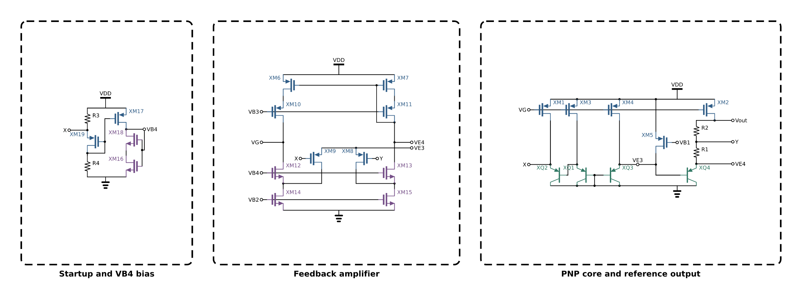

# 构图参考

[使用手册](../README.md) · [USC 示例](../examples/README.md)

## 从网表到原理图

[通用构图方法](netlist_to_usc_architecture_layout_reference.md) · [SKY130 实战复盘](REFERENCE.md)

[原始 SPICE](case/dut.spice) · [三端 MOS USC](case/dut-no-bulk.usc) · [显式体端 USC](case/dut-with-mos-bulk.usc) · [SVG](case/final.svg)

