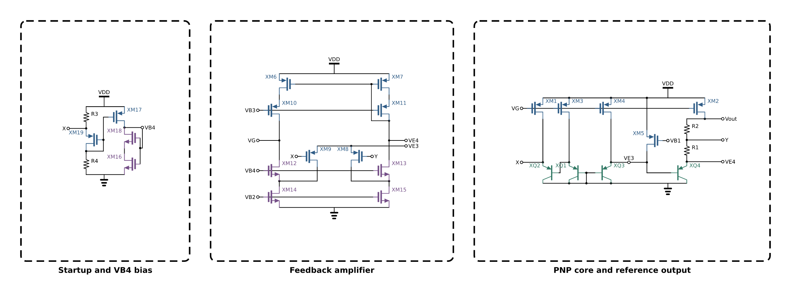
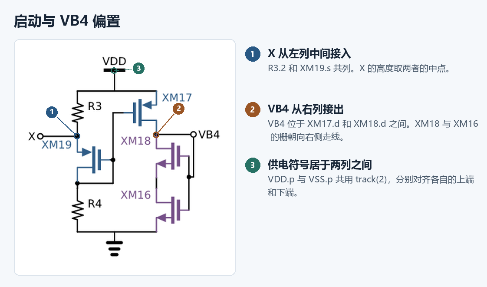
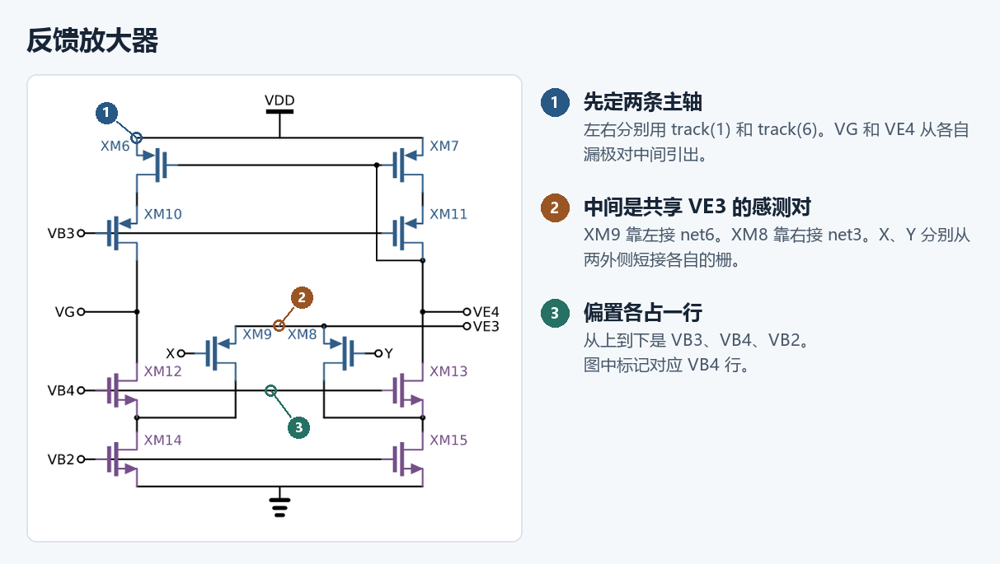
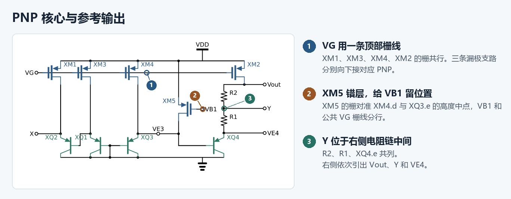
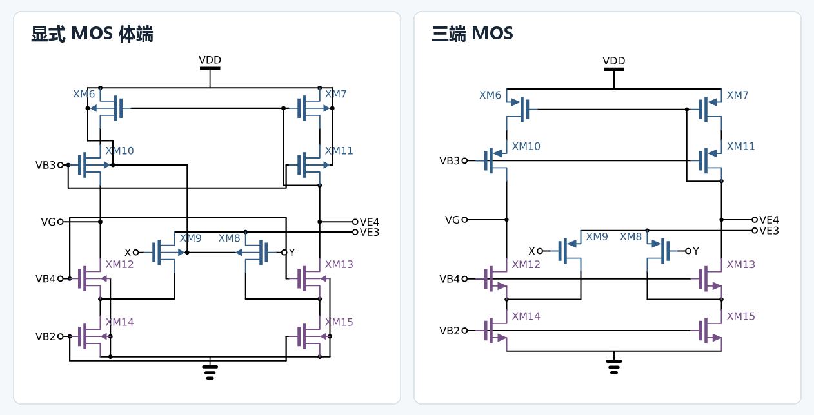

# 从 SPICE 网表到 USC 原理图

## SKY130 dut 的构图复盘与复用方法

这篇参考用一份 27 器件的网表，讲清楚从器件连通关系到原理图的设计过程。它记录了怎样识别并排支路、怎样划分模块、哪些端点值得共轨，以及实际出图后为何移动 XM5 和省略 MOS 体端的可见连线。想先看通用构图方法，可以从随附的参考稿开始。[通用构图参考](netlist_to_usc_architecture_layout_reference.md)



总图从左到右是启动与 VB4 偏置、反馈放大器、PNP 核心及参考输出。跨块接口沿用原网名。蓝色为 PMOS，紫色为 NMOS，绿色为 PNP，颜色用于区分器件类型。原始网表、两版 USC 和可放大的输出都收在本目录。[原始 SPICE](case/dut.spice) · [三端 USC](case/dut-no-bulk.usc) · [显式 MOS 体端 USC](case/dut-with-mos-bulk.usc) · [总图 SVG](case/final.svg)

## 一、先把端子和网络读对

我先从 `.subckt dut VDD VSS Vout VB1 VB2 VB3` 记下外部接口，再建立两份索引。一份按器件列端子，便于移植和复核。另一份按网名列接到它的器件和端子，便于识别支路、反馈和分块接口。器件编号或网表行顺序只用来查找。例如，编号挨着的 XM1 和 XM2 共用栅线，真正与 XM1 漏极形成近距离竖支路的却是 XQ2 的发射极。

| 原网中观察到的连接 | 对构图的直接影响 |
| --- | --- |
| XM6.d → `net2` → XM10.s，XM7.d → `net1` → XM11.s | 这两段最适合做左右竖支路的上半部。 |
| XM10.d 和 XM12.d 共用 `VG`，XM11.d 和 XM13.d 共用 `VE4` | 让每对漏极共列，保留竖直连接，并在中间接出水平线。 |
| XM12.s、XM14.d、XM9.d 共用 `net6`，另一侧用 `net3` | 左右轴要各留一个接点，让中间的感测管分别接回相邻轴。 |
| XM8.s 和 XM9.s 共用 `VE3`，两个栅分别取 `Y`、`X` | 可把两管摆在同一高度，将共源横线与左右各自的栅线分开。 |
| XM1、XM2、XM3、XM4 共用栅网 `VG`，XM5 的栅是 `VB1` | 前四管用一条横向栅线，XM5 留出独立的接入口和高度。 |
| `Vout → R2 → Y → R1 → VE4` | 两只电阻可以竖叠，三个命名节点沿同一条轴展开。 |

### 端子顺序查两遍

第一遍查仿真模型的形式端子。`X` 前缀代表子电路调用，实参顺序取决于库中的 `.subckt` 声明。本例上游 SKY130 的 1.8 V MOS 模型声明 `d g s b`。第二遍查 USC 所选符号的端子顺序，避免把仿真模型和图形符号的编号直接等同起来。默认 `standard-0.3` 中，`PMOS_4TERM` / `NMOS_4TERM` 是 `d g s b`，三端 `PMOS` / `NMOS` 是 `d g s`，`PNP` 是 `c b e`。[上游 PFET 模型](https://github.com/google/skywater-pdk-libs-sky130_fd_pr/blob/main/cells/pfet_01v8/sky130_fd_pr__pfet_01v8.pm3.spice) · [上游 NFET 模型](https://github.com/google/skywater-pdk-libs-sky130_fd_pr/blob/main/cells/nfet_01v8/sky130_fd_pr__nfet_01v8.pm3.spice)

**本例原始网表有一处仿真前要核对。** 上游 `sky130_fd_pr__pnp_05v5_W0p68L0p68` 声明 `c b e s`，提供的四条 `XQ` 调用各写了三个网名。这里把已有的三个网按 `c b e` 画出，第四端留给原仿真环境的模型或封装定义。若直接调用上游的四端模型，需要确认并补齐第四端连接。包内的 SPICE 文件按收到的文本保留。[上游 PNP 模型](https://github.com/google/skywater-pdk-libs-sky130_fd_pr/blob/main/cells/pnp_05v5/sky130_fd_pr__pnp_05v5_W0p68L0p68.model.spice) · [收到的网表](case/dut.spice)

三端图中，19 只 MOS 的原体端连接都先逐管核对过。PMOS 的体端均为 `VDD`，NMOS 的体端均为 `VSS`。原 SPICE 与显式体端 USC 保留这些连接，三端图用源码注释说明它们。若换成独立井、局部体偏置或各实例体端有所区别的电路，应先确定这些网是否是读者需要看到的电路信息，再选符号。

这几行可以并排看。`XM19` 的 D、G 同接 `net0`，去掉可见体端后，二极管接法照样原样画出。`R2` 的两个网络保持原顺序，`1k` 记录在原 SPICE 和 USC 注释中。

```text
SPICE          XM19 net0 net0 X   VDD sky130_fd_pr__pfet_01v8 l=0.15 w=1 nf=1 m=1
显式体端 USC    XM19 net0 net0 X   VDD PMOS_4TERM
三端绘图 USC    XM19 net0 net0 X       PMOS

SPICE          R2 Vout Y 1k
USC            R2 Vout Y RESISTOR
```

## 二、先找画面里应该留下的长线，再定模块

我从两种线出发。沿 D/S 或 C/E 追踪成串器件，找可以上下摆放的设备链。沿栅极或基极追踪扇出，找适合共高度的控制线。`VDD`、`VSS` 会在线路图里布成电源轨，但在第一次划功能块时，先观察普通网的连通关系，避免所有器件因为共电源就被拉成一组。

本例的分块依据是保住三段连续结构。启动块保住两条局部竖链和 `net0`、`net4`。反馈块保住两条主轴与中间 XM8/XM9。PNP 块保住镜像供电、两对 PNP 以及 R2–R1 输出支路。尤其要把 XM8/XM9 留在反馈块里，`net6`、`net3` 才能在图上直接显示它们如何接回相邻主轴。

| 模块 | 器件 | 读图顺序 |
| --- | --- | --- |
| `StartupBias` | XM16–XM19、R3、R4 | 从左侧 `X` 看二极管接法与 `net0`，再看右侧 `VB4` 和串叠 NMOS。 |
| `Feedback` | XM6–XM15 | 先看两条自上而下的竖链，再看中间 `X`、`Y` 感测和两边的控制线。 |
| `ReferenceOutput` | XM1–XM5、XQ1–XQ4、R1、R2 | 先看 `VG` 顶部栅线，再向下看 PNP，最后沿最右电阻链读 `Vout`、`Y`、`VE4`。 |

把跨块接口列出来就能检验划分是否值得。当前划分有六条普通跨块网，电源另外统一标识。若把每条匹配支路各做一块，原本一眼能读懂的栅线、支路接点就会拆成更多端口。若合成一个块，这六条网可显示成实体导线，但它们会和内部栅线、电源轨竞争同一片空间。遇到需要追完整闭环的场合可以试单块图，按本例的阅读任务，三个模块比较容易逐块核对。

| 跨块网 | 在哪些块出现 | 在图上追到哪里 |
| --- | --- | --- |
| `X` | 启动、反馈、PNP | R3 / XM19.s 接点、XM9.g、XM1.d / XQ2.e |
| `VB4` | 启动、反馈 | XM17.d / XM18.d 一侧、XM12.g 和 XM13.g |
| `VG` | 反馈、PNP | XM10.d / XM12.d 接点、四只顶部 PMOS 的栅轨 |
| `VE4` | 反馈、PNP | XM11.d / XM13.d 与上方负载栅、R1 下端和 XQ4.e |
| `VE3` | 反馈、PNP | XM8 / XM9 共源、XM4 / XM5 漏极、XQ3.e 与 XQ4.b |
| `Y` | 反馈、PNP | XM8.g、R2 与 R1 的接点 |

各块的 `port` 用同名网表示接口，图面在块内走到端口，跨块关系由端口名传达。每块有独立的电气连通检查。大图校对时，我再拿这张表把同名接口逐项追一遍，尤其检查 `VB4` 仍是内部网，以及 `VB1`、`VB2`、`VB3`、`Vout` 的去向和原 `.subckt dut` 的外部接口是否一致。

## 三、把位置意图拆成四种约束

### 用轨道表达列和相对顺序

同一条 `track` 上，列出的锚点有相同的 X 坐标，并按书写顺序从上往下排。小数是相邻整数列之间的插入位置。比如本例用 `track(3.5)` 给电源符号和中间器件各留出独立位置。需要两点的精确水平中点时，另写 `center_x`。

先圈出想要笔直的实际端点。例如，希望 XM10 与 XM12 的漏极上下接成竖线，就把 `XM10.d`、`XM12.d` 放到同一轨道。相同 X 属于这两个漏极，其他引脚的 X 由整个符号和朝向决定。每个器件只选一个落位锚点。`track` 里的裸器件名取变换后的图形包络中心，端口裸名直接指电气端点。用器件中心也可以画，但本例给关键竖轴明确选了引脚。

### 用朝向让线从预期的边出去

我在纸上先问每个栅信号从哪边来，再设置 `face`。左侧输入端口多用 `p:right`，右侧端口多用 `p:left`，表示电路向端口哪边接线。核心里的 `X` 和 `Y` 离各自的感测栅很近，放在模块内部，让短的横向接入顺着实际引脚方向走。

朝向选好后，必须同时看同一器件的其他脚。比如镜像 PMOS 的栅朝向会变，源极仍要向上。单给 MOS 一个栅方向可能还剩两种等价外形，需要用源极方向或同一器件的引脚顺序区分。竖放电阻也明确指定 `1:up 2:down`，这样 R2 和 R1 的实参顺序与图上沿电阻链阅读的顺序一致。

### 用对齐创建走廊，用顺序保护空间

我优先对齐希望共用一根横线的同网端点。比如 `align_y VB3 XM10.g XM11.g` 让读者看到同一横线上是一个偏置网。要在一个竖接点上引出水平端口，我把端口 Y 高度设为两个端点的中点。`align_y VG (XM10.d XM12.d)` 就是一例。它给 T 接一个确定高度，网络本身已在器件行里定义。

对于上下两颗竖放器件，`above 上端 下端` 应选真正需要隔开的端点。例如要在 XM12 的源和 XM14 的漏之间留连接空间，就写 `above XM12.s XM14.d`。只给两个器件名，比较的会是它们已选的锚点，未必对应这段连接的两端。

检查几何时，把对齐的点在草图上圈成组，把严格的上下关系画成箭头。如果同轨 FIFO 要求 `A` 在 `B` 上方，又要求 `align_y A B`，两条约束无解。如果箭头比较的是同一列中不同器件的非锚点，还要先算朝向带来的引脚偏移。这样可以区分真正的矛盾与看似同列的两根独立接线。

## 四、启动偏置块的位置决定



**① 左列对准 X 和 net0。** `track(1): R3.1, XM19.s, R4.1` 让 R3、XM19 和 R4 顺着一根竖轴排开。`X` 在左侧，`align_y X (R3.2 XM19.s)` 把它送进 R3 下端与 XM19 源极之间。`XM19` 的漏栅同网要感知 `net0`，所以仍画出 G 到 D 的接法。把它的栅朝右，正好面向右列 XM17 的栅。

**② 右列把 VB4 留在 XM17 与 XM18 之间。** `track(3): XM17.s, XM18.d, XM16.d` 建好三颗管的顺序。`VB4` 从右侧接到 XM17.d 与 XM18.d 之间，再接到 XM18 和 XM16 的栅。 两个栅都朝右，面向这一侧的支路。`net4` 留在 XM18.s 和 XM16.d 之间，顺着主轴读就能找到。

**③ 电源和地用中间的两个点统一高度。** 把 `VDD.p` 和 `VSS.p` 排在 `track(2)`，分别对齐上、下支路的相关端点。读者从居中的供电标记即可扫到两列。由于这块从外部主要交换 `X` 和 `VB4`，保留左右两端口就足以解释它与主电路的关系。

这个块的 `above` 主要用于在电阻与晶体管之间、上下两管之间保留竖直线段。我先保住两列和端点的上下顺序，再写两个端口中点，使得三个关键网出线位置都能从网表反查。

## 五、反馈放大器的位置决定



### ① 两条主轴先画成列

```usc
track(1): XM6.s, XM10.d, XM12.d, XM14.d
track(6): XM7.s, XM11.d, XM13.d, XM15.d
```

这样标的好处是读图时从一个电源端沿一侧往下走，可以依次经过负载、偏置栅控的管子和电流下拉支路。左右轴分别由 `net2 → VG → net6` 和 `net1 → VE4 → net3` 串起来。这里的顺序描述的是器件链与接点在图上的阅读方向，网名依旧按真实端子绑定。

`VG` 和 `VE4` 分别从相应漏极对的中间引出。`VG` 放在左边，因为它对应左列的漏–漏接点。`VE4` 放右边，除了从右列引出，也在块内往上回到 XM6/XM7 的栅。顶部两管的栅面向内侧，`VE4` 的公共栅线就可以跨越两列之间的区域。

### ② 把感测对放在两列中间

`XM9.d` 连左侧的 `net6`，`XM8.d` 连右侧的 `net3`。因此把 XM9 放在中间偏左、XM8 放在中间偏右，让各自漏极朝相邻主轴接出。若位置交换，两根漏极支线就要横跨对方。两只管的源极同接 `VE3`，让这两个源端等高，就能让这条共享线横跨两只管，而 `X`、`Y` 分别从两外侧短接各自的栅。这个排布同时满足三个具体意图。共享源线的阅读方向清楚，两根感测栅线短，两条漏极支路各自靠近目标列。

### ③ 让三条偏置各有一行

从上往下，`VB3` 对齐 XM10/XM11 的栅，`VB4` 对齐 XM12/XM13 的栅，`VB2` 对齐 XM14/XM15 的栅。左边端口列本身也按这套上下关系排列，中间插入 `VG`。这能预先看出哪些网的横向走廊互不冲突。

若某行最终仍出现折返，我会先查横线从哪个栅开始、经过哪些本体或引脚，以及这一行对应的是该器件的 G、D 还是 S。能减少冲突的改动通常落在朝向、锚点或占用的高度上。为了让布线器重新搜索而盲目多跑一轮，解决不了两根必须争用同一位置的线。

## 六、PNP 核心与输出的位置决定



**① 把同网栅和垂直 PNP 支路分开读。** XM1、XM3、XM4、XM2 的栅同接 `VG`，所以把它们的栅对齐成顶部横线。XM1 的漏极 `X` 向下读到 XQ2.e，XM3 的 `net5` 向下读到 XQ1.e，XM4 的 `VE3` 向下读到 XQ3.e。XQ2 的基极也接到 `net5`，把它的基极朝向相邻 XQ1 支路，能让读者顺着短线找到这个耦合点。

**② XM5 单独错层。** 预览时曾让 XM5 的源和其余 PMOS 齐平。它的 `VB1` 正好落在 `VG` 横向延伸到 XM2 的区域，标号和走线靠得太近。最终保留 XM5 的列和栅朝向，把 `XM5.s` 从顶部等高组拿出，再给它的栅一个明确高度。

```usc
align_y VDD.p XM1.s XM2.s XM3.s XM4.s
align_y VG XM1.g XM2.g XM3.g XM4.g
align_y VB1 XM5.g
align_y XM5.g (XM4.d XQ3.e)
```

这样 `VB1` 和顶部公共栅线在不同高度，`XM5.d` 仍向下接回 `VE3` 一侧，源极则从上方供电轨下来。选择这个改法，是因为需要独立走廊的是 XM5 的栅和 `VB1`。移动整组顶部器件会影响多个已读得顺的支路。这类局部调整可以先改一个位置关系，再看同一网和邻网的走向是否都更清楚。

**③ 电阻支路沿右侧一眼读到底。** `R2` 的上端与 XM2.d 同高并接 `Vout`，`R1` 在它下面。`Y` 从 R2 下端与 R1 上端之间横向接出，`VE4` 从 R1 下端与 XQ4.e 之间横向接出。在这三个位置上用端点和中点正好表达读图意图。

```usc
track(6): R2.1, R1.1, XQ4.e
track(8): Vout, Y, VE4
align_y Vout R2.1 XM2.d
align_y Y (R2.2 R1.1)
align_y VE4 (R1.2 XQ4.e)
```

## 七、怎样判断图确实更清楚



两张局部图使用同一套分块和位置约束。显式体端版增加了许多连到电源与地的端口和支线。在反馈块里，这些线与 `VB4`、`VB2` 的控制线争用走廊，部分本来希望笔直的偏置线出现了折返或贴得很近的平行线。三端版把这些统一连接的体端留在网表注释后，两条电源轨和三排栅线的关系更容易分辨。

| 绘图版本 | 启动块几何提示 | 反馈块几何提示 | PNP 与输出块几何提示 | 内部 LVS |
| --- | ---: | ---: | ---: | --- |
| 显式 MOS 体端 | 4 | 28 | 14 | 三块通过 |
| 三端 MOS | 2 | 0 | 0 | 三块通过 |

三端版保留的两个提示是启动块的 `body_clearance`。它们和本块的电气连通检查各自独立。读图时，我会单独看这些净距提示，再确认短线看起来像一个预期接点、跨越清楚、标号能读出。图通过 LVS，也仍值得核对视觉容易混淆的相邻线，以及跨块反馈是否能靠端口名全程追清楚。

这张图还可以用三个容易执行的检查来评估。先缩小看能否一眼看出三个块和各自的电源上下方向。再放大中间块对照两主列，顺着 `VB3`、`VB4`、`VB2` 各穿过一次。最后遮住器件编号，只看线、接点和网名，沿 `Vout → Y → XM8.g` 及 `VE4 → XM6/XM7.g` 追一下。第一轮检查帮忙发现画面拥挤，后两轮常能发现网络看似对齐却难分辨的地方。

## 八、把这次画法带到下一份网表

| 遇到的情况 | 先做的判断 | 在 USC 里的动作 |
| --- | --- | --- |
| 不知道从哪画起 | 找一段从电源经过两三只器件的连续主支路。 | 用一个 `track` 放这段的真实连接端点。 |
| 两条支路拓扑近似 | 标出同层器件的对应端，并标出中间会交换的网。 | 保留两条主轨。先对齐真正共用的电源和栅线。 |
| 一个器件同时接两处 | 找出主轴上需要精确直通的那一个端点。 | 只给它一个落位锚点，其余端点参与 `face`、`align_y` 或 `above`。 |
| 长水平线和辅助栅线碰到一起 | 看看是哪一颗辅助器件和哪一个端口共用高度。 | 先改局部高度，必要时用两真实端点的中点给一条线留走廊。 |
| 符号旁边有明显的小鱼钩 | 查线从端口朝哪边出、面对的是符号的哪一个引脚。 | 先核朝向和引脚位置，再看是否需要调整该端口列和高度。 |
| 两列被拉得很宽 | 找到真正跨度最大的网、连在它上的两端和挡在中间的块。 | 把相互配对的器件拉到邻轨，或把闭合局部连线留在同块。 |
| 布局报不可行 | 先核对同列 FIFO 与等高、严格高低之间是否有环。 | 用实际引脚重画这一组约束，每次只解除一个冲突。 |
| 打算省略某些端子 | 在源网表中逐项检查被省略端子的网络和作用。 | 让原始文件与绘图文件都可查，保留影响读图和功能判断的端子。 |

每轮调图我只选一个要验证的意图，例如让 `VB1` 可读或让一条偏置线更直。然后重新出图，核对器件端子实参确实没变，看新图是否实现这一意图，并查看 LVS 和几何提示。按这个顺序走，下一次看到改善或退化时，能知道是哪条布局决定造成的。

## 九、复现

解压官方发行包后，将其中的 `unischematic` 放进命令搜索路径，或在下面用它的完整路径。从本参考包根目录执行。首次使用可先看完整协议并确认接受。[官方发行包](https://github.com/KonataLin/UniSchematic/releases)

```powershell
unischematic --license
unischematic --accept-license
unischematic -instance PMOS -json
unischematic -instance PMOS_4TERM -json
unischematic -run case/dut-no-bulk.usc -out three-terminal-out -json
unischematic -run case/dut-with-mos-bulk.usc -out four-terminal-out -json
```

输出目录使用新名字，成功后各得到 `final.svg` 和 `final.png`。报告中逐块查看 `lvs_passed`、`connected`、`audit`，再看 `warnings` 有没有漏接跨块端口的提示。将图放大，按本页三个局部图的标记核对落位，最后回到原 SPICE 核对端子实参。两个 USC 文件可以并排比较，正常会看到 MOS 模型、体端和注释的区别，两版共享一套布局约束。[三端 USC](case/dut-no-bulk.usc) · [显式体端 USC](case/dut-with-mos-bulk.usc)
