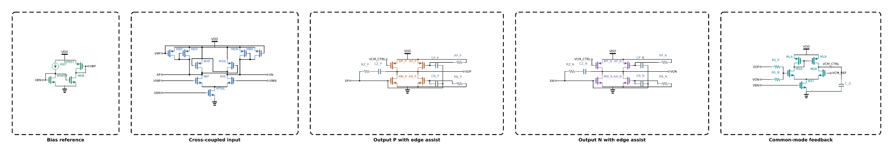
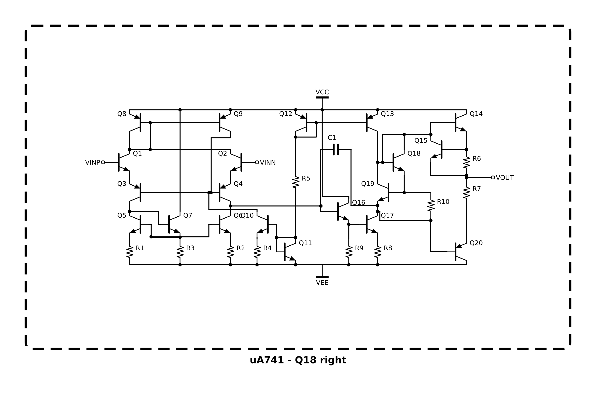

# USC 示例

[使用手册](../README.md) · [构图参考](../README.md#usc-layout-methods)

## Differential Edge OTA

[入口 USC](differential-edge-ota/main.usc) · [模块定义](differential-edge-ota/stages.usc) · [SVG](differential-edge-ota/final.svg)



## µA741

[入口 USC](ua741-q18-right/main.usc) · [SVG](ua741-q18-right/final.svg)



## 重跑

在解压后的发行目录运行以下命令。首次使用请先查看 `--license` 并确认协议。

```powershell
.\unischematic.exe -run examples/differential-edge-ota/main.usc -out ota-out
.\unischematic.exe -run examples/ua741-q18-right/main.usc -out ua741-out
```

Linux 和 macOS 使用 `./unischematic`。
